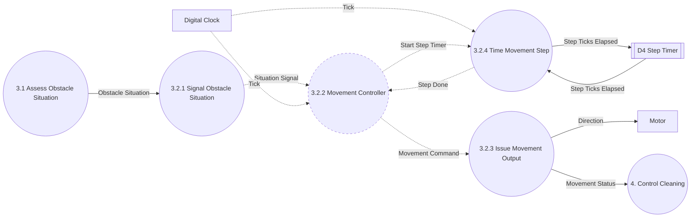

# DFD Level 3

System: RVC Controller
Parent: DFD Level 2, `artifacts/SA/DFD/dfd_level_2.md`
Sources: `docs/preliminary_requirements.md` (B1-B7), `docs/requirements_clarifications.md` (C1-C15, Q6), `artifacts/SA/DFD/dfd_level_0.md`, `artifacts/SA/DFD/dfd_level_1.md`, `artifacts/SA/DFD/dfd_level_2.md`

## Decomposition Scope

| Level 2 Process | Decomposed | Reason |
|---|---|---|
| 1 Detect Obstacle | No | Primitive since Level 2. |
| 2 Detect Dust | No | Primitive since Level 2. |
| 3.1 Assess Obstacle Situation | No | Primitive. A single stateless classification of D1 (see its Process Specification). |
| 3.2 Decide Movement | Yes → 3.2.1, 3.2.2, 3.2.3, 3.2.4 | It mixes control and data processing: it keeps the avoidance step across ticks (control state), counts the 5-tick stop, backward, and turn periods (C6, C7, C8), and produces the Direction and Movement Status data. Level 3 separates the control part as the Controller (sa-dfd Step 5.4). |
| 4.1 Track Power-Up | No | Primitive. It handles the numeric count in D3 and consumes the pending-dust Boolean in D2; these are data updates, not movement mode sequencing (C15). |
| 4.2 Decide Cleaning | No | Primitive. A stateless choice among three Clean values. |

## Diagram 3.2: Decide Movement

Solid arrows are data flows. Dashed arrows are control flows. `3.2.2 Movement Controller` is drawn with a dashed border: it is a control process. `3.1` and `4. Control Cleaning` are shown only as the source and destination of the parent's flows.

## Processes

| Process ID | Process Name | Type | Responsibility | Requirements |
|---|---|---|---|---|
| 3.2.1 | Signal Obstacle Situation | Data | Converts the Obstacle Situation data from 3.1 into a Situation Signal control flow for the Controller. | B3, B4, C1 |
| 3.2.2 | Movement Controller | Control | Keeps the current state (Forward, Stopping, Backing, Turning Right, Turning Left). On each Tick, uses Situation Signal and Step Done to choose the next state, issues one Movement Command, and starts the step timer when a 5-tick step begins. Specified by the Level 4 FSM. | B2, B3, B4, C1, C2, C4-C9, C13 |
| 3.2.3 | Issue Movement Output | Data | When a Movement Command arrives, sends the matching Direction to the Motor and the matching Movement Status to Process 4. | B2, B3, B4 |
| 3.2.4 | Time Movement Step | Data | Counts the ticks of the current stop, backward, or turn step in D4 and signals Step Done when 5 ticks have elapsed. | C6, C7, C8 |

## Data Store

| ID | Data Store | Contents | Written by | Read by | Justification |
|---|---|---|---|---|---|
| D4 | Step Timer | Step Ticks Elapsed (Idle or 0-5) | 3.2.4 | 3.2.4 | The 5-tick stop (C7), backward movement (C6), and turn (C8) must be counted across ticks. The count is numeric data, so it is kept outside the control process, like D3 for the power-up. |

## Controller Interface (input to Level 4)

| Item | Kind | Values |
|---|---|---|
| Tick | Input event (control) | — |
| Situation Signal | Input condition (control) | Front Blocked (yes or no) and Side Situation (Right Open, Left Open, Sides Blocked) |
| Step Done | Input condition (control) | Present on the tick when the running stop, backward, or turn step has lasted 5 ticks |
| Movement Command | Output action (control) | Forward, Stop, Turn Right, Turn Left, Backward |
| Start Step Timer | Output action (control) | — |
| Controller states | Internal | Forward (initial), Stopping, Backing, Turning Right, Turning Left |

## Controller Behavior

| Current State | Tick condition | Actions | Next State | Source |
|---|---|---|---|---|
| Forward | not Front Blocked | Forward | Forward | B2 |
| Forward | Front Blocked | Stop, Start Step Timer | Stopping | B3, C2, C7 |
| Stopping | not Step Done | Stop | Stopping | C7 |
| Stopping | Step Done and Right Open | Turn Right, Start Step Timer | Turning Right | B3, C1, C8 |
| Stopping | Step Done and Left Open | Turn Left, Start Step Timer | Turning Left | B3, C8 |
| Stopping | Step Done and Sides Blocked | Backward, Start Step Timer | Backing | B4, C6 |
| Backing | not Step Done | Backward | Backing | C6 |
| Backing | Step Done and Sides Blocked | Backward, Start Step Timer | Backing | C5, C6, C9 |
| Backing | Step Done and Right Open | Turn Right, Start Step Timer | Turning Right | C5, C8 |
| Backing | Step Done and Left Open | Turn Left, Start Step Timer | Turning Left | C5, C8 |
| Turning Right | not Step Done | Turn Right | Turning Right | C8 |
| Turning Right | Step Done | Forward | Forward | B3, B4, C8 |
| Turning Left | not Step Done | Turn Left | Turning Left | C8 |
| Turning Left | Step Done | Forward | Forward | B3, B4, C8 |

- **C4 applied:** obstacles do not disappear, so while the RVC is stopped the front stays blocked. Sides Blocked at the end of a stop therefore means front, left, and right are blocked (B4).
- **C9 applied (2026-11-16):** at the end of a backward step only the Side Situation decides. The front is not consulted, because moving backward takes the RVC away from the obstacle and the front sensor may read clear.
- **Durations:** stop, backward, and turn each last 5 ticks (C7, C6, C8). Turning is split into two states so that the same turn direction is issued for all 5 ticks.

## Balancing with Process 3.2

| Process 3.2 Flow | Direction | Category | Level 3 Process | Balanced |
|---|---|---|---|---|
| Obstacle Situation | Input | Data | 3.2.1 | Yes |
| Tick | Input | Control | 3.2.2, 3.2.4 | Yes (same event to both) |
| Direction | Output | Data | 3.2.3 | Yes |
| Movement Status | Output | Data | 3.2.3 | Yes |

Internal items added: `Situation Signal`, `Movement Command`, `Start Step Timer`, `Step Done` (control), `Step Ticks Elapsed` (data), Data Store D4.

## Overall Balancing with Level 0

| Level 0 Flow | Level 1 | Level 2 | Level 3 |
|---|---|---|---|
| Front Sensor Input | 1 | 1 | 1 |
| Left Sensor Input | 1 | 1 | 1 |
| Right Sensor Input | 1 | 1 | 1 |
| Dust Sensor Input | 2 | 2 | 2 |
| Tick | 3, 4 | 3.1, 3.2, 4.1 | 3.1, 3.2.2, 3.2.4, 4.1 |
| Direction | 3 | 3.2 | 3.2.3 |
| Clean | 4 | 4.2 | 4.2 |

No external flow was added or removed.

## Execution Order Within One Tick

0. Complete initial sampling before the first Tick (C12). Process sensor inputs received before this Tick through 1 and 2; retain pending dust even if a later FALSE input arrived. Input receipt and this Tick are logically serialized.
1. 3.1 reads D1 and produces Obstacle Situation; 3.2.1 converts it to Situation Signal.
2. 3.2.4 advances D4 and, if 5 ticks have elapsed, emits Step Done.
3. 3.2.2 takes its transition and issues Movement Command (and Start Step Timer when a step begins).
4. 3.2.3 produces Direction and Movement Status.
5. 4.1 uses Movement Status, the current/pending dust in D2 and D3. While Avoiding it preserves both pending dust and remaining ticks. On Forward it starts/restarts five ticks for current or pending dust, clears the consumed pending flag, then reports active and decrements D3. 4.2 produces Clean with C14 semantics.

Initialization before sampling: Forward state, D3=0, D4=Idle, pending dust=FALSE. No Movement Command, Direction or Clean is emitted on initialization (C13). The first Tick may issue Stop if its front sample is blocked.

## Open Issues Affecting Level 3 and Level 4

| ID | Affects | Status |
|---|---|---|
| Q1 → C5 | 3.2.2 | Resolved: turn right after backing; back again if left and right are still blocked. |
| Q2 → C6 | 3.2.2, 3.2.4 | Resolved: backward lasts 5 ticks. |
| Q3 → C7 | 3.2.2, 3.2.4 | Resolved: stop lasts 5 ticks. |
| C5 edge | 3.2.2 | Resolved: after backing, Left Open turns left (C5 updated). |
| C8 | 3.2.2, 3.2.4 | Resolved: a turn lasts 5 ticks. |
| Q4 → C10, Q5 → C11 | 4.1 | Resolved: dust during a power-up restarts the 5 ticks; the remaining count is kept while avoiding. |
| C9 | 3.1, 3.2.2 | Resolved: Obstacle Situation carries Front Blocked and Side Situation; after backing the sides decide. |
| Q6 | 3.1 | Assumption unchanged: only while Forward, side obstacles alone do not initiate avoidance when the front is clear. Side classification is always provided (C9). |

C12-C15 are the 2026-11-17 Phase 1 decisions: initial sampling, initialization without output, suction-only power-up, and remembered avoidance dust. They do not add states to the Movement Controller; D2/4.1 handle the remembered detection.
