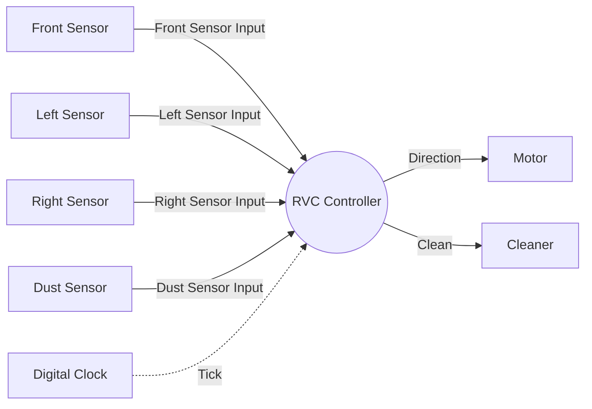

# System Context Diagram

System: RVC Controller
Sources: `docs/preliminary_requirements.md`, `docs/requirements_clarifications.md`, `artifacts/SA/event_list.md`

## System Boundary

- Inside: the automatic cleaning control logic of the RVC Controller (B7).
- Outside: the sensors and digital clock that supply inputs, and the motor and cleaner that receive commands. Their hardware design and control are out of scope (B6).

## Diagram

Solid arrows are data flows. The dashed arrow is a control flow.

## Initialization and output semantics

Before the first Tick, all four sensor readings are available (C12). Power On initializes state only and emits neither Direction nor Clean (C13); it is not a new external flow. Clean Start/Stop jointly enables/disables suction and mopping, and Power Up strengthens suction while mopping stays normal (C14). Dust detections retained for later use (C15) are internal state, not a new external event.
