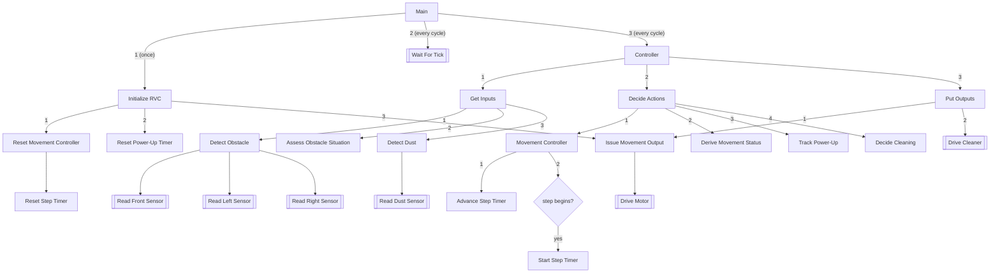
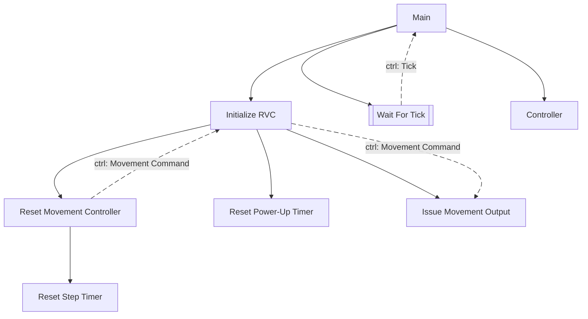
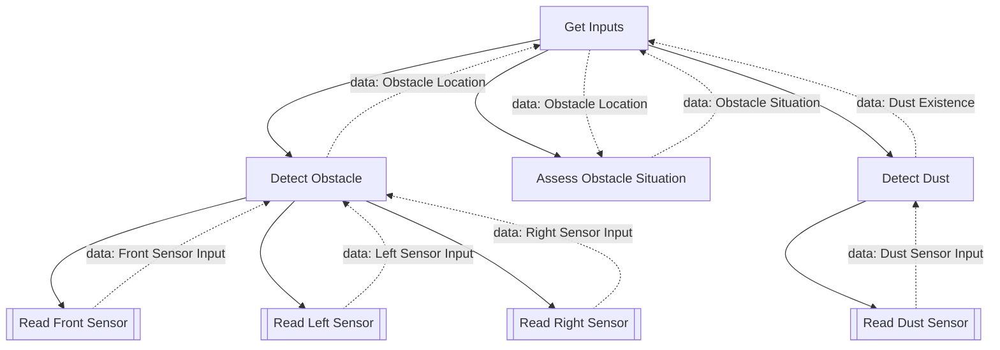
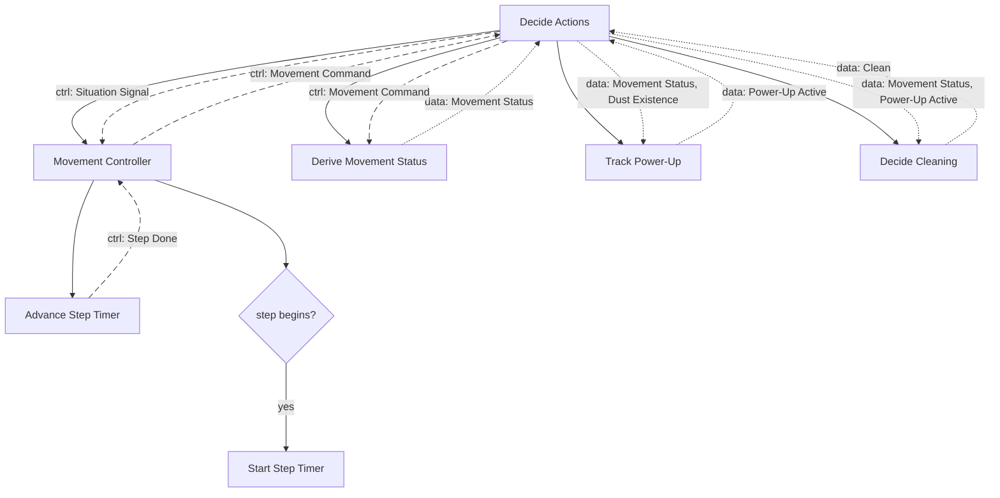
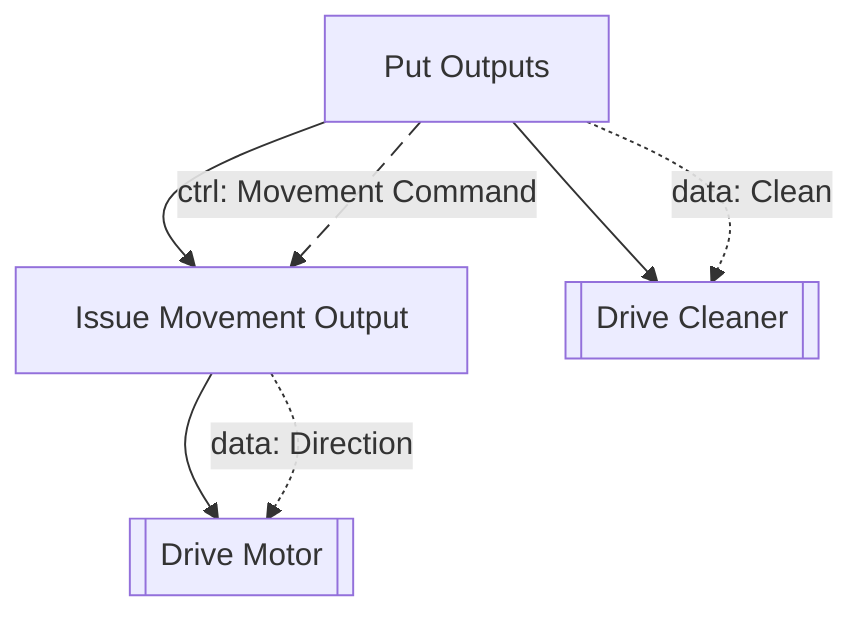

# Structure Chart

System: RVC Controller
Sources: `artifacts/SD/transform_analysis.md`, `artifacts/SA/DFD/dfd_level_0.md` to `dfd_level_3.md`, `artifacts/SA/DFD/dfd_level_4_fsm.md`, `artifacts/SA/process_specification.md`, `artifacts/SA/data_dictionary.md`, `artifacts/SA/context_diagram.md`, `artifacts/SA/event_list.md`
Requirement references: B1-B7 (`docs/preliminary_requirements.md`), C1-C8 and Q4-Q6 (`docs/requirements_clarifications.md`)

## 1. Objective

Represent the hierarchical software module structure of the RVC Controller, derived from the Transform Analysis and the approved SA artifacts. Each module is one intended C function. Each arrow is one intended function call.

## 2. Notation

| Element | Representation in this document |
|---|---|
| Module | Rectangle `[ ]` |
| Library module | Subroutine `[[ ]]`. Here: the hardware interface, whose internals are outside the design (B6). |
| Module call | Solid arrow from caller to callee. A number on the arrow is the call order within the caller. |
| Data information | Dotted arrow labeled `data:`, drawn in the direction the data moves. |
| Control information | Dashed arrow labeled `ctrl:`, drawn in the direction the information moves. |
| Conditional call | Diamond `{ }` between caller and callee. |
| Repeated call | `every cycle` on the arrow. |

Mermaid draws dotted and dashed lines almost alike. The `data:` and `ctrl:` prefixes are the reliable distinction. An item is `ctrl:` when the Data Dictionary classifies it as a control flow.

## 3. Module Hierarchy

### 3.1 Call hierarchy

- **Repetition:** `Main` calls `Initialize RVC` once. It then repeats `Wait For Tick` followed by `Controller` for as long as the system runs. The requirements define no shutdown event.
- **Condition:** `Movement Controller` calls `Start Step Timer` only on a transition that begins a 5-tick step (stop, backward, or turn).
- **Shared module:** `Issue Movement Output` is called by `Initialize RVC` and by `Put Outputs`.
- All other calls are made on every cycle, in the numbered order.

### 3.2 Top level and initialization, with exchanged information

`Main` passes nothing to `Initialize RVC` or `Controller` and receives nothing from them.

### 3.3 Control cycle, with exchanged information

```mermaid
%%{init: {"flowchart": {"nodeSpacing": 90, "rankSpacing": 260}}}%%
flowchart LR
    Ctrl["Controller"]
    GetIn["Get Inputs"]
    Decide["Decide Actions"]
    PutOut["Put Outputs"]

    Ctrl --> GetIn
    Ctrl --> Decide
    Ctrl --> PutOut

    GetIn -.->|"data: Obstacle Situation, Dust Existence"| Ctrl
    Ctrl -.->|"data: Obstacle Situation, Dust Existence"| Decide
    Decide -.->|"data: Clean"| Ctrl
    Ctrl -.->|"data: Clean"| PutOut

    Decide -.->|"ctrl: Movement Command"| Ctrl
    Ctrl -.->|"ctrl: Movement Command"| PutOut

    linkStyle 7,8 stroke-dasharray: 9 5
```

This one diagram is drawn left to right, with the caller on the left, so that its labels do not overlap.

### 3.4 Input branch (afferent)

### 3.5 Processing branch (central)

### 3.6 Output branch (efferent)

## 4. Module Descriptions

### 4.1 Modules

| Module | Region | Responsibility | Called Modules |
|---|---|---|---|
| Main | Root | Initializes the system once, then runs one control cycle for every Tick. Corresponds to the C `main()` function. | Initialize RVC, Wait For Tick, Controller |
| Initialize RVC | Root | Puts the system into its power-on condition (FSM transition T0): resets the hidden data and issues the initial Forward command. | Reset Movement Controller, Reset Power-Up Timer, Issue Movement Output |
| Controller | Root | Runs one control cycle: obtains the inputs, decides the actions, delivers the outputs. Coordinates Process 0 for one Tick. | Get Inputs, Decide Actions, Put Outputs |
| Get Inputs | Afferent | Obtains the two inputs the decisions need: Obstacle Situation and Dust Existence. | Detect Obstacle, Assess Obstacle Situation, Detect Dust |
| Detect Obstacle | Afferent | Reads the three obstacle sensors and returns them as one Obstacle Location. | Read Front Sensor, Read Left Sensor, Read Right Sensor |
| Assess Obstacle Situation | Afferent | Classifies an Obstacle Location: whether the front is blocked, and whether the right is open, only the left is open, or both sides are blocked (C1, C9). | — |
| Detect Dust | Afferent | Reads the dust sensor and returns Dust Existence. | Read Dust Sensor |
| Decide Actions | Central | Decides the Movement Command and the Clean command for this cycle. | Movement Controller, Derive Movement Status, Track Power-Up, Decide Cleaning |
| Movement Controller | Central | Takes one FSM transition (T1-T14) for this Tick and returns the Movement Command. Keeps the controller state. | Advance Step Timer, Start Step Timer |
| Reset Movement Controller | Central | Sets the controller state to Forward and returns the initial Movement Command, Forward (T0). | Reset Step Timer |
| Advance Step Timer | Central | Counts one tick of the running step and reports Step Done when 5 ticks have elapsed. Does nothing when no step is running. | — |
| Start Step Timer | Central | Begins counting a new 5-tick step. | — |
| Reset Step Timer | Central | Sets the step timer to Idle. | — |
| Derive Movement Status | Central | Returns Forward when the Movement Command is Forward, otherwise Avoiding. | — |
| Track Power-Up | Central | Starts and counts down the 5-tick power-up and reports whether it applies on this tick. Keeps the remaining count. | — |
| Reset Power-Up Timer | Central | Sets the remaining power-up count to 0. | — |
| Decide Cleaning | Central | Chooses Clean: Stop while avoiding, Power Up while power-up is active, otherwise Start. | — |
| Put Outputs | Efferent | Delivers the two decided commands to the Motor and the Cleaner. | Issue Movement Output, Drive Cleaner |
| Issue Movement Output | Efferent | Converts a Movement Command into the Direction value and sends it to the Motor. | Drive Motor |

### 4.2 Library modules (hardware interface)

Each stands for one terminator of the Context Diagram. Their internals are outside this design (B6). Unit tests and the simulator supply their own versions.

| Library Module | Terminator | Event (Event List) | Returns / Accepts |
|---|---|---|---|
| Read Front Sensor | Front Sensor | Front Sensor Input | Returns Boolean |
| Read Left Sensor | Left Sensor | Left Sensor Input | Returns Boolean |
| Read Right Sensor | Right Sensor | Right Sensor Input | Returns Boolean |
| Read Dust Sensor | Dust Sensor | Dust Sensor Input | Returns Boolean |
| Wait For Tick | Digital Clock | Tick | Returns when the next Tick occurs |
| Drive Motor | Motor | Direction | Accepts Forward, Backward, Turn Left, Turn Right, or Stop |
| Drive Cleaner | Cleaner | Clean | Accepts Start, Stop, or Power Up |

### 4.3 Hidden data

Data that must persist between cycles is hidden inside the group of modules that uses it. No other module can read or write it.

| Group | Modules | Hidden data | SA origin |
|---|---|---|---|
| Movement Controller | Movement Controller, Reset Movement Controller | Controller state: Forward, Stopping, Backing, Turning Right, Turning Left | States of the Level 4 FSM |
| Step Timer | Advance Step Timer, Start Step Timer, Reset Step Timer | Step Ticks Elapsed: Idle or 0-5 | Data Store D4 |
| Power-Up Timer | Track Power-Up, Reset Power-Up Timer | Remaining Power-Up Ticks: 0-5 | Data Store D3 |

## 5. Module Interfaces

"Input Data" is passed from caller to callee. "Output Data" is returned to the caller. In the last column, ↓ means passed to the callee and ↑ means returned to the caller.

| Caller | Callee | Input Data | Output Data | Control Information |
|---|---|---|---|---|
| Main | Initialize RVC | — | — | — |
| Main | Wait For Tick | — | — | ↑ Tick |
| Main | Controller | — | — | — |
| Initialize RVC | Reset Movement Controller | — | — | ↑ Movement Command (Forward) |
| Reset Movement Controller | Reset Step Timer | — | — | — |
| Initialize RVC | Reset Power-Up Timer | — | — | — |
| Initialize RVC | Issue Movement Output | — | — | ↓ Movement Command |
| Controller | Get Inputs | — | Obstacle Situation, Dust Existence | — |
| Controller | Decide Actions | Obstacle Situation, Dust Existence | Clean | ↑ Movement Command |
| Controller | Put Outputs | Clean | — | ↓ Movement Command |
| Get Inputs | Detect Obstacle | — | Obstacle Location | — |
| Get Inputs | Assess Obstacle Situation | Obstacle Location | Obstacle Situation | — |
| Get Inputs | Detect Dust | — | Dust Existence | — |
| Detect Obstacle | Read Front Sensor | — | Front Sensor Input | — |
| Detect Obstacle | Read Left Sensor | — | Left Sensor Input | — |
| Detect Obstacle | Read Right Sensor | — | Right Sensor Input | — |
| Detect Dust | Read Dust Sensor | — | Dust Sensor Input | — |
| Decide Actions | Movement Controller | — | — | ↓ Situation Signal, ↑ Movement Command |
| Movement Controller | Advance Step Timer | — | — | ↑ Step Done |
| Movement Controller | Start Step Timer | — | — | — (conditional call) |
| Decide Actions | Derive Movement Status | — | Movement Status | ↓ Movement Command |
| Decide Actions | Track Power-Up | Movement Status, Dust Existence | Power-Up Active | — |
| Decide Actions | Decide Cleaning | Movement Status, Power-Up Active | Clean | — |
| Put Outputs | Issue Movement Output | — | — | ↓ Movement Command |
| Put Outputs | Drive Cleaner | Clean | — | — |
| Issue Movement Output | Drive Motor | Direction | — | — |

Types and values of every item are those of the Data Dictionary. `Decide Actions` passes the Obstacle Situation it received to `Movement Controller` as the Situation Signal; the value is the same.

## 6. SA-to-SD Traceability

### 6.1 Processes

| SA Process ID | SA Process Name | SD Module | Design Rationale |
|---|---|---|---|
| 0 | RVC Controller | Main, Initialize RVC, Controller | Main supplies the Tick loop. Controller performs Process 0 once per Tick. |
| 1 | Detect Obstacle | Detect Obstacle | One to one. |
| 2 | Detect Dust | Detect Dust | One to one. |
| 3 | Control Movement | Modules of 3.1 and 3.2 | Parent process; realized by its children. |
| 3.1 | Assess Obstacle Situation | Assess Obstacle Situation | One to one. |
| 3.2 | Decide Movement | Modules of 3.2.1 to 3.2.4 | Parent process; realized by its children. |
| 3.2.1 | Signal Obstacle Situation | Decide Actions (parameter passing) | 3.2.1 only hands a value on as a signal. A module for it would have no body, so the hand-over is the call `Decide Actions → Movement Controller`. |
| 3.2.2 | Movement Controller | Movement Controller, Reset Movement Controller | Movement Controller takes T1-T14. Reset Movement Controller takes T0. |
| 3.2.3 | Issue Movement Output | Derive Movement Status, Issue Movement Output | Split along the transform boundary: Movement Status feeds the decisions (central), Direction goes to the Motor (efferent). Each module now has one function. |
| 3.2.4 | Time Movement Step | Advance Step Timer, Start Step Timer, Reset Step Timer | One module per trigger of 3.2.4 (Tick, Start Step Timer) plus its initial value. They share D4 as hidden data. |
| 4 | Control Cleaning | Modules of 4.1 and 4.2 | Parent process; realized by its children. |
| 4.1 | Track Power-Up | Track Power-Up, Reset Power-Up Timer | Track Power-Up is the process. Reset Power-Up Timer gives D3 its initial value. |
| 4.2 | Decide Cleaning | Decide Cleaning | One to one. |

Modules with no SA process of their own:

| SD Module | Origin |
|---|---|
| Get Inputs, Decide Actions, Put Outputs | The three regions of the Transform Analysis. They only coordinate their branch. |
| Initialize RVC | FSM transition T0 (Power On) and the initial values of D3 and D4. |
| Library modules | Terminators of the Context Diagram. |

### 6.2 Control flows and Data Stores

DFD flows are not copied as calls. This table shows what each control flow and Data Store became.

| SA item | SA kind | Realized in the design as |
|---|---|---|
| Tick | Control flow | The return of `Wait For Tick`, after which `Main` calls `Controller` once. It is not passed as a parameter. |
| Situation Signal | Control flow | Parameter of `Movement Controller`. |
| Step Done | Control flow | Return value of `Advance Step Timer`. |
| Start Step Timer | Control flow | The call `Movement Controller → Start Step Timer` itself. |
| Movement Command | Control flow | Return value of `Movement Controller`; parameter of `Derive Movement Status` and `Issue Movement Output`. |
| D1 Obstacle Location | Data Store | Return value of `Detect Obstacle`, passed to `Assess Obstacle Situation` in the same cycle. Not kept between cycles. |
| D2 Dust Existence | Data Store | Return value of `Detect Dust`, passed on to `Track Power-Up` in the same cycle. Not kept between cycles. |
| D3 Power-Up Timer | Data Store | Hidden data of the Power-Up Timer group. |
| D4 Step Timer | Data Store | Hidden data of the Step Timer group. |
| Controller state | FSM states | Hidden data of the Movement Controller group. |

All other data flows are the parameters and return values listed in section 5.

### 6.3 Controller FSM

| FSM element | Design element |
|---|---|
| T0 (Power On / Forward) | `Reset Movement Controller` sets the state and returns Forward. `Initialize RVC` passes it to `Issue Movement Output`. |
| T1-T14 (Tick) | One call of `Movement Controller` takes exactly one of these transitions. |
| Condition: Situation Signal | Parameter of `Movement Controller`. |
| Condition: Step Done | Obtained from `Advance Step Timer` at the start of every call, before the transition is chosen. |
| Action: Movement Command | Return value of `Movement Controller`. |
| Action: Start Step Timer | Call of `Start Step Timer` on T2, T4, T5, T6, T8, T9, T10 only. |

## 7. Design Decisions Needing Approval

These go beyond what the SA artifacts state. Each is a design choice, not a requirement.

| # | Decision | Reason |
|---|---|---|
| 1 | The sensors are read once per cycle, at its start. D1 and D2 therefore need no storage between cycles. | In the SA, Processes 1 and 2 run "when the sensor input is received", and the stores hold the latest reading for the next Tick. Reading at each Tick gives the same latest reading. How sensor hardware delivers its input is out of scope (B6). |
| 2 | Seven library modules represent the hardware. | A C program needs a function to call for each external event. The Context Diagram defines exactly these seven events. |
| 3 | The initial power-up count is 0. | The Data Dictionary defines 0 as "no power-up in progress", but no SA artifact states an initial value for D3. D4's initial value (Idle) is stated in Process Specification 3.2.4. |
| 4 | Read-only queries of the hidden data (controller state, Step Ticks Elapsed, Remaining Power-Up Ticks) may be added for unit tests and the simulator. | The simulator must display these values at every tick. No production module calls such queries, so they are not in the chart. |

One consequence of the approved SA is kept as it is: at power on, only Direction = Forward is issued (T0). Clean is first issued on the first Tick, because Processes 4.1 and 4.2 run on Tick.

## 8. Design Validation

| Check | Result |
|---|---|
| Every SA function is implemented by at least one module | Yes. All 9 leaf processes are mapped in 6.1; 3.2.1 is realized by parameter passing. |
| Every module has a clear responsibility | Yes. See 4.1. |
| Module calls represent actual invocation | Yes. Every arrow is a function call. DFD control flows that are not calls are listed in 6.2. |
| Data and control information are distinguishable | Yes. Labeled `data:` and `ctrl:` in 3.2-3.6 and separated in section 5. |
| Module interfaces are consistent | Yes. Each item returned by one module is passed unchanged to the module that uses it; names match the Data Dictionary. |
| Consistent with Process Specifications | Yes. Each module's logic is its process's specification. The order within a cycle follows "Execution Order Within One Tick" of DFD Level 3, with one difference: Direction is delivered at the end of the cycle, together with Clean, not before Process 4.1 runs. Both are still delivered within the same Tick. |
| Controller calls are consistent with the FSM | Yes. See 6.3. |
| Coupling | Modules exchange only parameters and return values. There is no global data. Persistent data is confined to the three groups in 4.3. Obstacle Location is passed as one record, and its receiver uses all three fields. |
| Cohesion | Leaf modules each perform one function. Controller, Get Inputs, Decide Actions, and Put Outputs only sequence their callees. Initialize RVC groups actions by time (power on), which is usual for initialization. |
| Fan-out and fan-in | Largest fan-out is 4 (Decide Actions). Issue Movement Output has fan-in 2. |
| No unsupported modules or behavior | The additions are the coordinating modules, the reset modules, and the library modules. Their origins are in 6.1; the choices behind them are in section 7. |

### Decisions made after approval (2026-11-16)

C9, C10, and C11 changed the inside of three modules. No module, call, or interface name changed.

| ID | Affects | Effect on the design |
|---|---|---|
| C9 | Assess Obstacle Situation, Movement Controller | Obstacle Situation (and so the Situation Signal) is now a record: Front Blocked plus Side Situation. After a backward step the Controller decides by the sides only. |
| C10 | Track Power-Up | Dust during a running power-up restarts the 5 ticks. |
| C11 | Track Power-Up | The remaining count is kept while avoiding. Confirms what the module already did. |
| Q6 | Movement Controller | Assumption kept: while going forward only Front Blocked is used. |

The open issues listed at approval time (Q4, Q5) are resolved by C10 and C11. Q6 remains an assumption.
