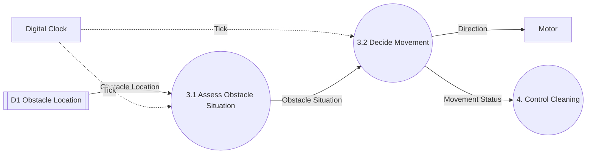
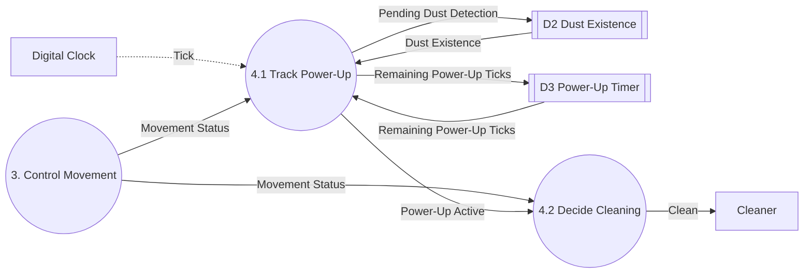

# DFD Level 2

System: RVC Controller
Parent: DFD Level 1, `artifacts/SA/DFD/dfd_level_1.md`
Sources: `docs/preliminary_requirements.md` (B1-B7), `docs/requirements_clarifications.md` (C1-C16), `artifacts/SA/event_list.md`, `artifacts/SA/context_diagram.md`, `artifacts/SA/DFD/dfd_level_0.md`, `artifacts/SA/DFD/dfd_level_1.md`

## Decomposition Scope

| Level 1 Process | Decomposed | Reason |
|---|---|---|
| 1 Detect Obstacle | No | Functional primitive. It copies three Boolean sensor values into D1; splitting it into per-sensor processes would add no function the requirements describe. Its Level 1 Process Specification is complete. |
| 2 Detect Dust | No | Functional primitive. It updates the current dust Boolean and latches a pending detection in D2 (C15). |
| 3 Control Movement | Yes → 3.1, 3.2 | It mixes two functions: classifying the obstacle situation (B3, B4, C1, C16) and sequencing the movement over several ticks (stop, turn, backward, forward; B3, B4, C2). |
| 4 Control Cleaning | Yes → 4.1, 4.2 | It mixes two functions: counting the 5-tick power-up (B5, C3) and choosing the cleaning command (B1-B3, B5). |

## Diagram 3: Control Movement

Solid arrows are data flows. Dashed arrows are control flows. `[[ ]]` nodes are Data Stores. `4. Control Cleaning` is a sibling Level 1 process, shown only as the destination of `Movement Status`.

### Processes

| Process ID | Process Name | Responsibility | Requirements |
|---|---|---|---|
| 3.1 | Assess Obstacle Situation | On each Tick, reads D1 and classifies the obstacles into one Obstacle Situation. Always classifies the sides with right priority (C1, C9), independently of the front. C16 restricts only Forward avoidance entry. | B3, B4, C1, C9, C16 |
| 3.2 | Decide Movement | On each Tick, chooses the Direction from the Obstacle Situation and the current avoidance step: stop first (C2), then turn, or move backward then turn; go forward when clear. Reports Movement Status to Process 4. | B2, B3, B4, C1, C2 |

The avoidance step (stopping, turning, moving backward) is control state that persists across ticks. It stays inside 3.2 at this level. Level 3 separates it from 3.2 as the Controller, which Level 4 describes as an FSM.

### Balancing with Process 3

| Process 3 Flow | Direction | Category | Level 2 Process | Balanced |
|---|---|---|---|---|
| Obstacle Location (from D1) | Input | Data | 3.1 | Yes |
| Tick | Input | Control | 3.1, 3.2 | Yes (same event to both) |
| Direction | Output | Data | 3.2 | Yes |
| Movement Status | Output | Data | 3.2 | Yes |

Internal flow added: `Obstacle Situation` (3.1 → 3.2).

## Diagram 4: Control Cleaning

Solid arrows are data flows. Dashed arrows are control flows. `[[ ]]` nodes are Data Stores. `3. Control Movement` is a sibling Level 1 process, shown only as the source of `Movement Status`.

### Processes

| Process ID | Process Name | Responsibility | Requirements |
|---|---|---|---|
| 4.1 | Track Power-Up | On each Tick, starts/restarts a 5-tick power-up on current or pending dust while Forward, consumes the pending flag, and counts down. While Avoiding, preserves D3 and the pending flag. | B5, C3, C10, C11, C15 |
| 4.2 | Decide Cleaning | Chooses the Clean command: Stop while avoiding, Power Up while power-up is active, otherwise Start. Runs when 4.1 reports Power-Up Active for the tick. Start/Stop affect suction and mopping together; Power Up strengthens suction only. | B1, B2, B3, B5, C14 |

### Data Store

| ID | Data Store | Contents | Written by | Read by | Justification |
|---|---|---|---|---|---|
| D3 | Power-Up Timer | Remaining Power-Up Ticks (0-5) | 4.1 | 4.1 | The 5-tick count (C3) persists across ticks and freezes during avoidance (C11). Initial value: 0 before initial sensor sampling. |

### Balancing with Process 4

| Process 4 Flow | Direction | Category | Level 2 Process | Balanced |
|---|---|---|---|---|
| Dust Existence (from D2) | Input | Data | 4.1 | Yes |
| Movement Status | Input | Data | 4.1, 4.2 | Yes (same flow to both) |
| Tick | Input | Control | 4.1 | Yes |
| Clean | Output | Data | 4.2 | Yes |
| Pending Dust Detection (to D2) | Output | Data | 4.1 | Yes |

Internal items added: `Power-Up Active` (4.1 → 4.2), `Remaining Power-Up Ticks` (4.1 ↔ D3), Data Store D3. `Pending Dust Detection` (4.1 → D2) crosses the Process 4 boundary and matches the Level 1 output; it updates only the pending field, not the current Dust Detected value. D2 is external to Process 4, not a newly introduced internal store.

## Overall Balancing with Level 0

| Level 0 Flow | Level 1 Process | Level 2 Process |
|---|---|---|
| Front Sensor Input | 1 | 1 (not decomposed) |
| Left Sensor Input | 1 | 1 (not decomposed) |
| Right Sensor Input | 1 | 1 (not decomposed) |
| Dust Sensor Input | 2 | 2 (not decomposed) |
| Tick | 3, 4 | 3.1, 3.2, 4.1 |
| Direction | 3 | 3.2 |
| Clean | 4 | 4.2 |

No system-external flow was added or removed. Obstacle Situation, Power-Up Active, Remaining Power-Up Ticks and D3 are internal to their respective parent processes. Pending Dust Detection crosses Process 4's boundary to D2, matching the revised Level 1 boundary; it remains internal to Process 0.

## Decisions and remaining assumption

Q1-Q5 are resolved by C5-C7/C10-C11; C8 sets the turn duration. Stopping, Backing and Turning each last five ticks. After Backing only Side Situation decides (C9): right when clear, else left when clear, else back again. C4 preserves physical obstacles, not sensor readings across motion; front remains blocked while stationary in Stopping.

C16 resolves Q6 for Forward avoidance entry: a clear front means continued forward movement and cleaning, regardless of side obstacles. Process 3.1 always supplies both Front Blocked and Side Situation, including when the front is clear.

C15 resolves the formerly unnumbered avoidance-dust question. Process 2 latches every TRUE input in D2; Process 4.1 preserves it while Avoiding and clears it only after a Forward Tick starts/restarts five ticks. Repeated detections coalesce. With no pending/current dust, C11 resumes the saved count. D3 starts at 0. C12-C13 govern initial sampling and output timing; C14 defines the suction/mopping meaning of Clean.
