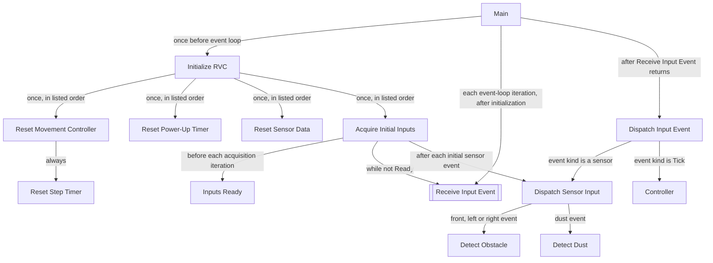
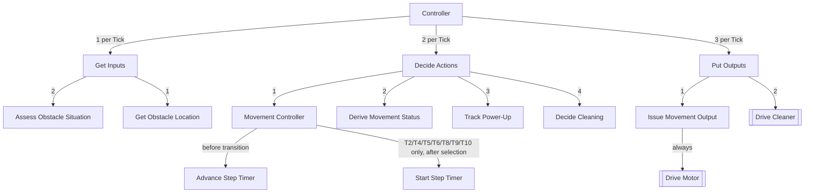
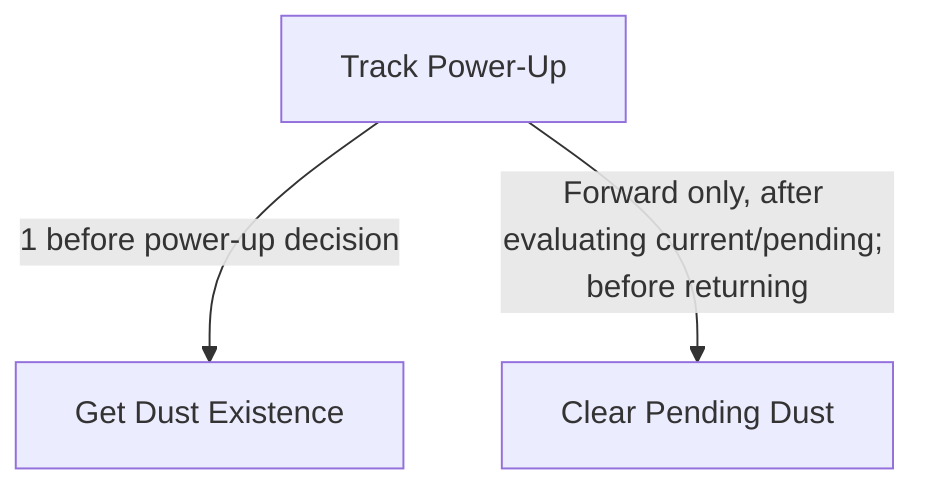
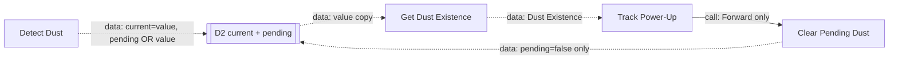

# Structure Chart

System: RVC Controller. Revision: 2026-11-18 Phase 4 corrections.
Sources: `transform_analysis.md`, current `artifacts/SA/` DFD 0–4, Data Dictionary and Process Specifications, `docs/preliminary_requirements.md`, `docs/requirements_clarifications.md`.
Requirement references: B1–B7, C1–C16. Q1–Q6 are resolved; Q6 is confirmed C16.

## 1. Objective and revision status

Derive C11 module responsibilities, call hierarchy and interfaces from the current SASD artifacts. Each module below is one intended C function; no production C is changed by this document. This revision implements the owner's authorized Phase 4 fixes. Earlier SD approval applies to its earlier revision; human approval of this revised SD is pending.

## 2. Input boundary and execution contract

The Context Diagram still has exactly the same seven external flows: Front/Left/Right/Dust Sensor Input, Tick, Direction and Clean. Software packaging of the five incoming flows is changed to one **Receive Input Event** adapter. The former four Read Sensor functions and Wait For Tick are superseded design interfaces, not additional required public APIs.

`Input Event` is a design tagged value: kind ∈ {Front, Left, Right, Dust, Tick}; each sensor kind carries its actual Boolean value; Tick has no Boolean payload. `Sensor Input Event` excludes Tick. `Input Mode` is design control/configuration (InitialSensors or Running), not a new external event. Valid input kinds and values are a boundary precondition; no unsupported error/recovery behavior is invented.

**InitialSensors contract:** the adapter actively obtains/delivers actual initial readings from all four sensors. It returns only sensor events in receipt order. It preserves any received TRUE then FALSE dust updates during acquisition; events are not collapsed into only their latest value. Acquire Initial Inputs dispatches each observation, checking readiness until all four fields have actual values. The adapter guarantees eventual delivery of those initial samples under the existing available-sensors assumption. Tick delivery is not enabled during this initial acquisition; there is no pre-initialization Tick to discard or replay. This is the C12/SA first-Tick boundary, not a new periodic-clock requirement.

**Running contract:** the adapter returns sensor observations and Tick in a single receipt order. Every received sensor event before a Tick must be dispatched before that Tick; later events are processed afterwards. Simultaneous arrivals are serialized by that same boundary order; no new sensor-over-Tick priority is assumed. Input reception must retain observations while a Tick is executing, without dropping or coalescing TRUE/FALSE dust events. A simulator/test adapter can supply this ordered stream; hardware capture/transport details are outside B6. Sampling only the current sensor value once per Tick cannot satisfy this contract. The implementation must later demonstrate the boundary contract; it is not considered verified here.

All software dispatch occurs in one sequential event loop. No input callback mutates D1/D2 during Controller. There are no separate concurrent writers or writable store pointers. A sensor event updates only its store; it never advances D3/D4, takes a movement transition or emits an output. Each Tick executes exactly one complete Controller cycle. Ticks continue under the existing clock assumption; C5 allows repeated Backing without guaranteeing eventual Forward.

Initialization order: Reset Movement Controller (Forward, D4=Idle) → Reset Power-Up Timer (D3=0) → Reset Sensor Data (invalid sensor fields, pending=false) → Acquire Initial Inputs. The first TRUE dust sample sets pending; no reset is performed after sampling. Initialize RVC and every function reachable through its initialization calls return no Movement Command and emit no Direction/Clean (C13). Once initialization returns, Main first calls Receive Input Event in Running mode; the first Tick may immediately select Stop if front is blocked.

## 3. Call hierarchy

Rectangles are internal modules; double rectangles are boundary/library modules. Solid arrows are calls, labelled with order or condition. These are not DFD flow arrows. For data/return/control values, the authoritative call table is section 5. The diagrams together cover every call in that table; shared modules appear in more than one view.

### 3.1 Event loop and initialization



### 3.2 One Tick: input, decision and output



### 3.3 D2 access in power-up processing



The D2 feedback is a store update, not a call from the sensor module back into the controller. Detect Dust and the D2 accessors operate on private Sensor Store data. Track Power-Up invokes the accessor; its caller does not receive a writable D2 record.



This last view illustrates encapsulated data access and the Forward-only call; dashed labelled arrows are data movement, not extra function calls.

## 4. Module descriptions and hidden data

### 4.1 Internal modules

| Module | Region | Responsibility | Called modules |
|---|---|---|---|
| Main | Root | Initialize once, then receive and dispatch one ordered input event at a time. | Initialize RVC, Receive Input Event, Dispatch Input Event |
| Initialize RVC | Root | Reset movement, D3 and Sensor Store; acquire initial samples. Return only when all four samples are valid; emit no command (C12/C13). | Reset Movement Controller, Reset Power-Up Timer, Reset Sensor Data, Acquire Initial Inputs |
| Acquire Initial Inputs | Root | Until Inputs Ready, obtain InitialSensors events and dispatch only sensor inputs. Preserve all intermediate TRUE dust observations. | Inputs Ready, Receive Input Event, Dispatch Sensor Input |
| Dispatch Input Event | Root | For a sensor event call Dispatch Sensor Input; for Tick call Controller once. The branches are mutually exclusive. | Dispatch Sensor Input, Controller |
| Dispatch Sensor Input | Afferent | Route front/left/right values to Detect Obstacle and dust values to Detect Dust. Never call Controller or any output module. | Detect Obstacle, Detect Dust |
| Controller | Root | For one Tick: Get Inputs, Decide Actions, Put Outputs. No sensor dispatch interleaves with this cycle. | Get Inputs, Decide Actions, Put Outputs |
| Get Inputs | Afferent | Read a valid D1 snapshot and classify it. Dust is read directly by Track Power-Up through the Sensor Store accessor. | Get Obstacle Location, Assess Obstacle Situation |
| Detect Obstacle | Afferent | Update only the named D1 sensor field and its valid flag; preserve the other fields (P1). | — |
| Assess Obstacle Situation | Afferent | Produce Front Blocked and Side Situation independently; right priority (C1/C9). | — |
| Detect Dust | Afferent | Set current=value; pending=old_pending OR value; mark dust valid. FALSE preserves pending (P2/C15). | — |
| Reset Sensor Data | Afferent | Set valid flags false and pending=false. Current sensor slots are invalid until populated by actual input; zero is not an assumed reading. | — |
| Inputs Ready | Afferent | Return true exactly when front, left, right and dust have all received a valid actual sample. | — |
| Get Obstacle Location | Afferent | Return a value copy of the three valid D1 readings. No writable state reference escapes. | — |
| Get Dust Existence | Afferent | Return a value copy of D2 current and pending. Does not consume or clear the detection. | — |
| Clear Pending Dust | Afferent storage access | Set only pending=false. Leave current and validity unchanged. Called only by Track Power-Up on Forward. | — |
| Decide Actions | Central | Select movement, derive Movement Status, track power-up, then decide cleaning. | Movement Controller, Derive Movement Status, Track Power-Up, Decide Cleaning |
| Movement Controller | Central | Advance D4, take exactly one T1-T14 transition, and restart D4 only when that transition starts a timed step. | Advance Step Timer, Start Step Timer |
| Reset Movement Controller | Central | Set Forward state and reset D4 to Idle; return no Movement Command (T0/C13). | Reset Step Timer |
| Advance Step Timer | Central | If running, increment elapsed; at 5 emit Step Done and set Idle. Run before the FSM transition. | — |
| Start Step Timer | Central | Set elapsed=0 after the transition requests a new step; its command Tick is the first of five. | — |
| Reset Step Timer | Central | Set D4 to Idle. | — |
| Derive Movement Status | Central | Return Forward for a Forward command, otherwise Avoiding (P3.2.3 central part). | — |
| Track Power-Up | Central | Read D2; preserve D3 and pending while Avoiding. On Forward apply current/pending restart precedence, consume pending, report active and decrement D3. | Get Dust Existence, Clear Pending Dust |
| Reset Power-Up Timer | Central | Set D3=0 as specified by current SA; no cleaning output. | — |
| Decide Cleaning | Central | Choose Stop while Avoiding; otherwise Power Up if active, else Start. Use C14 meanings. | — |
| Put Outputs | Efferent | Deliver Movement Command through Issue Movement Output, then Clean through Drive Cleaner, within this Tick. | Issue Movement Output, Drive Cleaner |
| Issue Movement Output | Efferent | Map Movement Command to Direction and call Drive Motor (P3.2.3 efferent part). | Drive Motor |

### 4.2 Library/boundary modules

| Module | Context terminators | Contract |
|---|---|---|
| Receive Input Event | Four sensor terminators and Digital Clock | Input Mode → one Input Event; ordered, lossless received-event contract in section 2 |
| Drive Motor | Motor | Direction → hardware boundary; no return data |
| Drive Cleaner | Cleaner | Clean → hardware boundary; Start/Stop affect suction+mop, Power Up suction only |

Grouping five input terminators in one adapter is a design choice. Their identities and semantics remain distinct in the tagged record. Motor and Cleaner remain separate output boundaries. No hardware implementation is specified.

### 4.3 Hidden data and ownership

| Group | Member modules | Private data | SA origin and access rule |
|---|---|---|---|
| Sensor Store | Reset Sensor Data, Inputs Ready, Detect Obstacle, Detect Dust, Get Obstacle Location, Get Dust Existence, Clear Pending Dust | D1's three values; D2 current and pending; four validity flags | P1/P2 and D1/D2. Only these members access storage directly. Getters return copies. Only Detect Dust sets pending by OR; only Clear Pending Dust consumes it during operation. Reset is initialization-only. |
| Movement Controller | Movement Controller, Reset Movement Controller | State: Forward, Stopping, Backing, TurningRight, TurningLeft | P3.2.2 / Level 4 FSM |
| Step Timer | Advance Step Timer, Start Step Timer, Reset Step Timer | D4: Idle or elapsed 0–5 | P3.2.4; reaches 5 transiently, emits Done, then Idle |
| Power-Up Timer | Track Power-Up, Reset Power-Up Timer | D3: remaining 0–5 | P4.1; initially 0 in current PSPEC/Dictionary |

Readiness flags distinguish unreceived values from actual FALSE samples. Accessing sensor value copies requires the corresponding fields to be valid; Controller requires all four. The input adapter may buffer events as a boundary mechanism, but it is not a second owner of the authoritative D2 pending flag. Queries for tests/simulator may return copies without granting mutation; they are not production control calls in this chart.

## 5. Module interfaces

Input Data is passed to the callee, Output Data is returned. Control Information records occurrence/enum control values. Conditions are part of the invocation contract. No raw pointer to hidden data is returned. Sensor ID, validity, Input Mode and Input Event are supporting design types; domain fields retain Data Dictionary values.

| Caller | Callee | Input Data | Output Data | Control Information | Order / condition |
|---|---|---|---|---|---|
| Main | Initialize RVC | — | — | — | once before event loop |
| Main | Receive Input Event | Input Mode=Running | Input Event | — | each event-loop iteration, after initialization |
| Main | Dispatch Input Event | Input Event | — | — | after Receive Input Event returns |
| Initialize RVC | Reset Movement Controller | — | — | — | once, in listed order |
| Initialize RVC | Reset Power-Up Timer | — | — | — | once, in listed order |
| Initialize RVC | Reset Sensor Data | — | — | — | once, in listed order |
| Initialize RVC | Acquire Initial Inputs | — | — | — | once, in listed order |
| Acquire Initial Inputs | Inputs Ready | — | Ready | — | before each acquisition iteration |
| Acquire Initial Inputs | Receive Input Event | Input Mode=InitialSensors | Sensor Input Event | — | while not Ready |
| Acquire Initial Inputs | Dispatch Sensor Input | Sensor Input Event | — | — | after each initial sensor event |
| Dispatch Input Event | Dispatch Sensor Input | Sensor Input Event | — | — | event kind is a sensor |
| Dispatch Input Event | Controller | — | — | Tick occurrence | event kind is Tick |
| Dispatch Sensor Input | Detect Obstacle | Sensor ID, Boolean value | — | — | front, left or right event |
| Dispatch Sensor Input | Detect Dust | Dust Sensor Input | — | — | dust event |
| Controller | Get Inputs | — | Obstacle Situation | — | 1 per Tick |
| Controller | Decide Actions | Obstacle Situation | Clean | ↑ Movement Command | 2 per Tick |
| Controller | Put Outputs | Clean | — | ↓ Movement Command | 3 per Tick |
| Get Inputs | Get Obstacle Location | — | Obstacle Location | — | 1 |
| Get Inputs | Assess Obstacle Situation | Obstacle Location | Obstacle Situation | — | 2 |
| Decide Actions | Movement Controller | — | — | ↓ Situation Signal, ↑ Movement Command | 1 |
| Decide Actions | Derive Movement Status | — | Movement Status | ↓ Movement Command | 2 |
| Decide Actions | Track Power-Up | Movement Status | Power-Up Active | — | 3 |
| Decide Actions | Decide Cleaning | Movement Status, Power-Up Active | Clean | — | 4 |
| Movement Controller | Advance Step Timer | — | — | ↑ Step Done | before transition |
| Movement Controller | Start Step Timer | — | — | — | T2/T4/T5/T6/T8/T9/T10 only, after selection |
| Reset Movement Controller | Reset Step Timer | — | — | — | always |
| Track Power-Up | Get Dust Existence | — | Dust Existence | — | 1 before power-up decision |
| Track Power-Up | Clear Pending Dust | — | — | — | Forward only, after evaluating current/pending; before returning |
| Put Outputs | Issue Movement Output | — | — | ↓ Movement Command | 1 |
| Put Outputs | Drive Cleaner | Clean | — | — | 2 |
| Issue Movement Output | Drive Motor | Direction | — | — | always |

`Decide Actions` forwards Obstacle Situation as Situation Signal, unchanged, realizing P3.2.1 without a separate empty function. The two fields are Front Blocked and Side Situation. RightOpen has priority even when both sides are clear. C16 restricts only avoidance entry while Forward; after Backing C9 uses the sides regardless of front.

### 5.1 Sensor updates and power-up contract

The following is design pseudocode implementing existing PSPEC 2/4.1, not production C or new business behavior:

```text
Detect Dust(value):
    D2.current = value
    D2.pending = D2.pending OR value
    dust_valid = TRUE

Track Power-Up(status):
    dust = Get Dust Existence()         // value copy; no clearing
    IF status == Avoiding:
        RETURN FALSE                  // D3 and D2.pending unchanged
    IF dust.current OR dust.pending:
        D3 = 5                        // C15 overrides saved partial count
    Clear Pending Dust()              // Forward only; current unchanged
    active = (D3 > 0)
    IF active: D3 = D3 - 1
    RETURN active
```

A start/restart at t powers suction on t..t+4 absent another detection or avoidance; the stored count after t is 4. Continuous TRUE current dust restarts on every Forward Tick per C10. Multiple pending detections coalesce into one restart. Without current/pending dust, a saved count resumes under C11. TRUE then FALSE before the next Tick leaves pending TRUE. No input dispatch can interleave between Get Dust Existence and Clear Pending Dust; an input received during Controller remains ordered for later dispatch.

Clean is Stop (suction and mopping both off) while Avoiding; otherwise Power Up strengthens suction only with normal mopping, or Start runs normal suction and mopping (C14). Direction and Clean are delivered within the same Tick after decisions, as the existing SD output-phase design specifies.

## 6. SA-to-SD traceability

### 6.1 Processes

| SA process | SD realization | Design rationale |
|---|---|---|
| 0 | Main, Initialize RVC, Acquire Initial Inputs, Dispatch Input Event, Controller | Initial readiness and serial event/Tick coordination; C12/C13. |
| 1 | Dispatch Sensor Input, Detect Obstacle, Get Obstacle Location | Identify sensor, preserve D1 fields, expose valid value copy. |
| 2 | Dispatch Sensor Input, Detect Dust, Get Dust Existence | Retain current/pending D2 for each received dust input; C15. |
| 3 | Children of 3.1/3.2 | Movement parent. |
| 3.1 | Assess Obstacle Situation | Raw record to independent front and sides with right priority. |
| 3.2 | Children of 3.2.1–3.2.4 | Movement sequencing parent. |
| 3.2.1 | Decide Actions parameter passing | Obstacle Situation becomes Situation Signal without transformation. |
| 3.2.2 | Movement Controller, Reset Movement Controller | T1–T14 on Tick; T0 initializes only. |
| 3.2.3 | Derive Movement Status, Issue Movement Output | Split central status and efferent Direction. |
| 3.2.4 | Advance Step Timer, Start Step Timer, Reset Step Timer | Two triggers and initial D4=Idle. |
| 4 | Children of 4.1/4.2 | Cleaning parent. |
| 4.1 | Track Power-Up, Reset Power-Up Timer, Get Dust Existence, Clear Pending Dust | D3 count and D2 observation/Forward-only consumption; C10/C11/C15. |
| 4.2 | Decide Cleaning | Clean decision with C14 semantics. |

Get Inputs, Decide Actions and Put Outputs coordinate the transform regions. Reset Sensor Data and Inputs Ready realize SA initial D1/D2 validity and pending initialization. Sensor Store accessors realize store access without exposing storage. Dispatch functions realize SA input-event triggers, not new external functionality. Receive Input Event realizes the five existing incoming Context flows. Drive Motor/Cleaner realize the two existing outgoing flows.

### 6.2 Stores and control flows

| SA item | Design realization |
|---|---|
| D1 Obstacle Location | Persistent latest received values inside Sensor Store, with validity. Read by Get Inputs via Get Obstacle Location. |
| D2 Dust Existence | Persistent current + pending inside Sensor Store. Detect Dust records every observation; Track Power-Up reads through a getter and consumes via Clear Pending Dust. |
| Pending Dust Detection | Forward-only pending-field update through Clear Pending Dust, corresponding to P4.1→D2; does not replace current. |
| D3 Power-Up Timer | Private remaining count in Power-Up Timer group; initial 0 is already specified in SA. |
| D4 Step Timer | Private elapsed/Idle state in Step Timer group. |
| Tick | Input Event kind Tick; Dispatch Input Event invokes Controller once. |
| Situation Signal | Control parameter from Decide Actions to Movement Controller. |
| Movement Command | Movement Controller return, passed to Derive Movement Status and Put Outputs/Issue Movement Output. No such return from reset. |
| Step Done | Advance Step Timer return before movement selection. |
| Start Step Timer | Conditional call after movement selection. |

### 6.3 FSM and timing

T0 sets only Forward state; no Movement Command, Direction, Clean or timer start is emitted. Every subsequent Tick selects T1–T14 exactly once. Only T2/T4/T5/T6/T8/T9/T10 call Start Step Timer. Advance runs first; a step started at t has elapsed 0 after t, 1..4 at t+1..t+4 and Done at t+5. At Done a turn returns Forward, or Stopping/Backing chooses the sides and starts the next step. C5 permits repeated Backing; C9 ignores front at that decision. While Forward a clear front retains Forward regardless of sides (confirmed C16).

## 7. Design decisions and approval record

| Decision | Basis and consequence |
|---|---|
| One ordered event adapter instead of polling-only sensor reads | SA event-triggered P1/P2, C12/C15. Changes software input APIs; actual capture implementation remains B6 scope exclusion. Test/simulator adapters must supply initial samples and ordered later events. |
| Serial event loop, no input reentrancy during Tick | SA Process 0 logical serialization. Allows value-copy D2 read then pending clear without losing a concurrently dispatched detection. |
| Persistent encapsulated Sensor Store with accessors | D1 latest-value semantics and D2 pending lifetime. Avoids external mutable globals; flags are initialization support. |
| Initialization acquires actual samples and does not output | C12/C13. No new requirement; supersedes old initial Forward and same-cycle-only storage design. |
| D3=0 | Current PSPEC 0/4.1 and Data Dictionary; no longer an unsupported design assumption. |
| Data/decisions/output remain separated within a Tick | Original transform mapping; Movement Status computed before D3/Clean; outputs delivered together at end of same Tick. |

Historical approval and 2026-11-16 C9–C11 updates apply to their historical revisions. The 2026-11-18 changes implement the already confirmed C12–C16 decisions and Phase 4 findings P4-01–P4-06. Q4/Q5 are resolved by C10/C11, Q6 by C16. This document does not assert that old C, tests or simulator already satisfy the revised interfaces. Revised SD human approval remains pending; QA.md holds the current review and approval status.

## 8. Review criteria and downstream work

Review module responsibilities, every call/interface/condition and every SA mapping together; compare the event-boundary and initial-readiness contracts with C12/C15. Confirm pending-only consumption, current-value preservation, and countdown/restart precedence. C11 and C9 remain unchanged except for C15's explicit restart precedence already in SA.

The existing `tests/expected_calls.txt` describes the earlier call graph (including initialization output and wait_for_tick). It is not updated or treated as proof of this design. After human approval, C-compliance review and authorized TDD must reconcile production interfaces, expected calls, unit scenarios and simulator input delivery. Current document consistency checks, rendered diagrams and independent review results are recorded separately under artifacts/Review; this section does not pre-claim test success.
