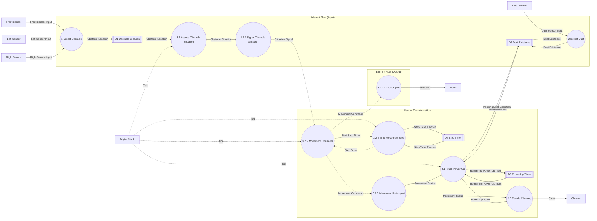

# Transform Analysis

System: RVC Controller
Sources: `artifacts/SA/DFD/dfd_level_0.md` to `dfd_level_3.md`, `artifacts/SA/DFD/dfd_level_4_fsm.md`, `artifacts/SA/process_specification.md`, `artifacts/SA/data_dictionary.md`, `artifacts/SA/context_diagram.md`, `artifacts/SA/event_list.md`
Requirement references: B1-B7 (`docs/preliminary_requirements.md`), C1-C16; Q1-Q6 resolved (`docs/requirements_clarifications.md`)

## 1. Objective

Identify the Afferent Flow, Central Transformation, and Efferent Flow of the RVC Controller from the current SA DFD hierarchy (C12-C16 revision; human approval of this revised SD remains pending), as the basis for the Structure Chart (`artifacts/SD/structure_chart.md`).

The analysis uses the leaf processes of the hierarchy. Processes 0, 3, 3.2, and 4 are parents and are represented by their children:

| Parent | Leaf processes |
|---|---|
| 0 RVC Controller | all of the below |
| 3 Control Movement | 3.1, 3.2.1, 3.2.2, 3.2.3, 3.2.4 |
| 3.2 Decide Movement | 3.2.1, 3.2.2, 3.2.3, 3.2.4 |
| 4 Control Cleaning | 4.1, 4.2 |

Processes 1 and 2 are leaves at Level 1.

## 2. Transform Regions

### Afferent Flow (Input)

Processes that receive the sensor inputs and raise them to the form the decision logic uses.

| Process ID | Process Name | Input | Output |
|---|---|---|---|
| 1 | Detect Obstacle | Front Sensor Input, Left Sensor Input, Right Sensor Input | Obstacle Location (to D1) |
| 3.1 | Assess Obstacle Situation | Obstacle Location (from D1), Tick | Obstacle Situation |
| 3.2.1 | Signal Obstacle Situation | Obstacle Situation | Situation Signal |
| 2 | Detect Dust | Dust Sensor Input, previous Dust Existence (pending field from D2) | Dust Existence (current reading and latched pending flag, to D2) |

Rationale:
- 1 records the latest obstacle inputs. 2 records the current dust input and ORs each TRUE detection into the pending flag in D2 (C15). This is input-history retention, not a cleaning decision.
- 3.1 turns the three raw readings into one Obstacle Situation. It describes the surroundings; it does not choose an action, so it is still input processing.
- 3.2.1 hands that description to the Controller as a signal without changing its value.
- Situation Signal and Dust Existence are the most abstract forms of the inputs. The next process to use each of them makes a decision.

### Central Transformation (Process)

Processes that decide what the RVC does.

| Process ID | Process Name | Input | Output |
|---|---|---|---|
| 3.2.2 | Movement Controller | Tick, Situation Signal, Step Done | Movement Command, Start Step Timer |
| 3.2.4 | Time Movement Step | Tick, Start Step Timer, Step Ticks Elapsed (from D4) | Step Done, Step Ticks Elapsed (to D4) |
| 3.2.3 (part) | Issue Movement Output: Movement Status | Movement Command | Movement Status |
| 4.1 | Track Power-Up | Tick, Dust Existence (from D2), Movement Status, Remaining Power-Up Ticks (from D3) | Power-Up Active, Remaining Power-Up Ticks (to D3), Pending Dust Detection (pending-only update to D2) |
| 4.2 | Decide Cleaning | Movement Status, Power-Up Active | Clean |

Rationale:
- 3.2.2 is the control process of the system (the Level 4 FSM). It chooses the movement.
- 3.2.4 works only for 3.2.2: it is started by the Controller and reports back to it. It is part of the control loop, not an input or an output path.
- 4.1 decides whether powered-up cleaning applies on this tick. It preserves D2 pending and D3 during Avoiding; on Forward it starts/restarts five ticks for current/pending dust, consumes pending, otherwise resumes the saved count (C10/C11/C15).
- 4.2 is where the Clean value is first formed. Before 4.2 there is no cleaning command, only Movement Status and Power-Up Active, so 4.2 belongs to the decision logic.

### Efferent Flow (Output)

Processes that deliver a decision that has already been made.

| Process ID | Process Name | Input | Output |
|---|---|---|---|
| 3.2.3 (part) | Issue Movement Output: Direction | Movement Command | Direction |

Rationale:
- The movement decision already exists as Movement Command when it reaches 3.2.3. Turning it into Direction for the Motor changes its form, not its content.
- Clean has no efferent process. It flows from 4.2 directly to the Cleaner.

### Process 3.2.3 lies on the boundary

3.2.3 has two outputs with different roles, so it is listed in two regions:

| Output of 3.2.3 | Used by | Region |
|---|---|---|
| Direction | Motor (terminator) | Efferent |
| Movement Status | 4.1 and 4.2 (decision logic) | Central |

If 3.2.3 were placed whole in the efferent region, Movement Status would flow from the output side back into the decision logic. The Structure Chart therefore separates the two responsibilities into two modules.

## 3. Transform Boundaries

- **Afferent-to-Central Boundary:** after 3.2.1 on the obstacle path, and after 2 (at D2) on the dust path.
- **Central-to-Efferent Boundary:** after 3.2.2 on the movement path, and after 4.2 on the cleaning path.
- **Boundary Data Flows:** Dust Existence (afferent → central), Pending Dust Detection (central → D2 in the afferent region), Clean (central → Cleaner).
- **Boundary Control Flows:** Situation Signal (afferent → central), Movement Command (central → efferent).

| Boundary flow | Category | From | To | Why the boundary is here |
|---|---|---|---|---|
| Situation Signal | Control | 3.2.1 | 3.2.2 | Last point where the obstacle input is only a description. 3.2.2 turns it into an action. |
| Dust Existence | Data | 2 (via D2) | 4.1 | Current and remembered dust form the input to the power-up decision. |
| Pending Dust Detection | Data | 4.1 | D2 | A Forward Tick consumes pending; only this field is cleared, preserving current dust. This feedback crosses the transform boundary. |
| Movement Command | Control | 3.2.2 | 3.2.3 | First point where the movement output exists. After it, only the form changes. |
| Clean | Data | 4.2 | Cleaner | First point where the cleaning output exists. It needs no further processing. |

**Tick** is not transformed by any afferent process. It triggers 3.1, 3.2.2, 3.2.4, and 4.1 directly. In the design it becomes the trigger of one control cycle, not a value that is passed around.

## 4. Transform Analysis Diagram

Solid arrows are data flows. Dashed arrows are control flows. `3.2.2` has a dashed border because it is the control process. All names are those of the DFDs; `3.2.3` appears twice, once for each of its outputs.

## 5. Result

| Region | DFD processes | Role in the Structure Chart |
|---|---|---|
| Afferent | 1, 2, 3.1, 3.2.1 | Input branch: obtains Obstacle Situation and Dust Existence. |
| Central | 3.2.2, 3.2.4, 3.2.3 (Movement Status), 4.1, 4.2 | Processing branch: decides Movement Command and Clean. |
| Efferent | 3.2.3 (Direction) | Output branch: delivers Direction to the Motor and Clean to the Cleaner. |

Every leaf process is assigned to a region. No process was added, and no flow was renamed.

## 6. Input lifetime, initialization and scheduling (2026-11-18 revision)

D1 holds the latest three received obstacle values. D2 persists current Dust Detected and Pending Dust Detection across inputs and ticks. Process 2 reads only the previous pending field before writing the new record. Process 4.1 updates only pending after a Forward Tick. Input recording and Tick execution are logically serialized (SA Process 0); a later FALSE never erases a remembered TRUE.

The SD realizes the same five incoming event types (four sensors and Tick) using one ordered input-event adapter. This changes software packaging, not the Context boundary. Sensor events update D1/D2 without taking an FSM transition. Tick alone triggers the control cycle. Hardware capture/transport is outside B6; its boundary contract must preserve received events, including a TRUE followed by FALSE between ticks.

Initialization sets Forward state, D3=0, D4=Idle, pending=FALSE and all sensor-valid flags false. Acquire all four actual initial readings before enabling the first Tick delivery (C12). No Direction or Clean is emitted during initialization (C13). Readiness flags and tagged input events are design support data, not new external functions or SA data flows.

The three transform regions remain useful even with the feedback into D2. Store ownership is encapsulated in the Structure Chart's Sensor Store group; neither a DFD arrow nor this feedback implies a module call by itself. C14 defines Start/Stop for suction and mopping together and Power Up for suction only. C16 is confirmed; Forward avoidance entry uses only the front, whereas C9 still controls post-backing side selection.

Earlier approvals refer to the earlier artifact revision. This update implements the owner's authorized Phase 4 corrections; it does not declare revised SD approval or C conformance.
