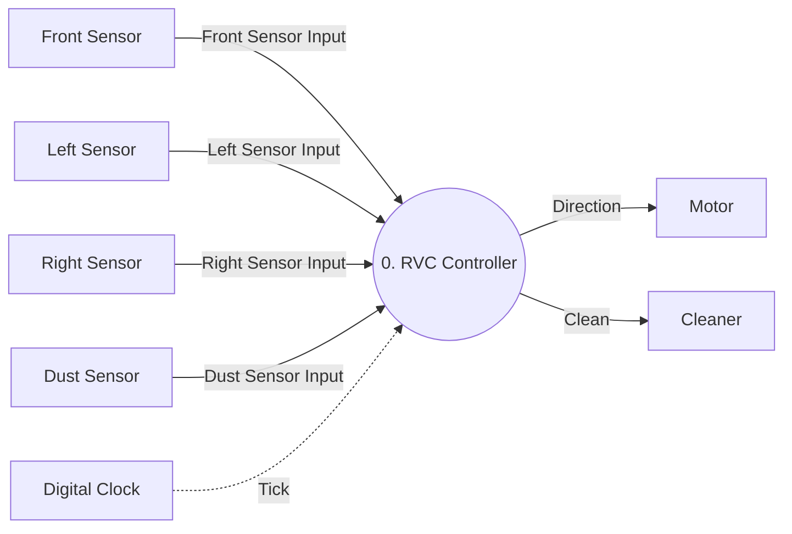

# DFD Level 0

System: RVC Controller
Sources: `docs/preliminary_requirements.md`, `docs/requirements_clarifications.md`, `artifacts/SA/event_list.md`, `artifacts/SA/context_diagram.md`

## Diagram

Solid arrows are data flows. The dashed arrow is a control flow.

## Process

| Process ID | Process Name | Responsibility |
|---|---|---|
| 0 | RVC Controller | Turns sensor inputs and clock ticks into movement and cleaning commands. |

## Balancing with the Context Diagram

| Flow | Direction | Category | External Entity | Context Diagram | Level 0 |
|---|---|---|---|---|---|
| Front Sensor Input | Input | Data | Front Sensor | Yes | Yes |
| Left Sensor Input | Input | Data | Left Sensor | Yes | Yes |
| Right Sensor Input | Input | Data | Right Sensor | Yes | Yes |
| Dust Sensor Input | Input | Data | Dust Sensor | Yes | Yes |
| Tick | Input | Control | Digital Clock | Yes | Yes |
| Direction | Output | Data | Motor | Yes | Yes |
| Clean | Output | Data | Cleaner | Yes | Yes |

Level 0 introduces no flows, Data Stores, or internal processes beyond the Context Diagram.
