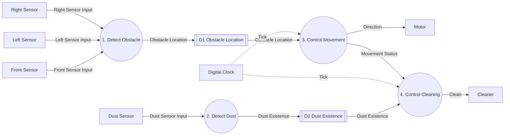

# DFD Level 1

System: RVC Controller
Parent: Process 0 (RVC Controller), `artifacts/SA/DFD/dfd_level_0.md`
Sources: `docs/preliminary_requirements.md` (B1-B7), `docs/requirements_clarifications.md` (C1-C3, Q1-Q6), `artifacts/SA/event_list.md`, `artifacts/SA/context_diagram.md`

## Diagram

Solid arrows are data flows. Dashed arrows are control flows. `[[ ]]` nodes are Data Stores.

All four processes are data processes. No control process is introduced at this level: control and data processing are separated at Level 3, where the Controller is identified for the Level 4 FSM (sa-dfd Step 5.4).

## Processes

| Process ID | Process Name | Responsibility | Requirements |
|---|---|---|---|
| 1 | Detect Obstacle | Reads the front, left, and right sensor inputs and records where obstacles are. | B3, B4, C1 |
| 2 | Detect Dust | Reads the dust sensor input and records whether dust is present. | B5 |
| 3 | Control Movement | On each Tick, decides the movement from the obstacle locations: go forward, stop, turn right or left, or move backward. Reports whether the RVC is moving forward or avoiding an obstacle. | B2, B3, B4, C1, C2 |
| 4 | Control Cleaning | On each Tick, decides the cleaning command from the movement status and dust existence: start, stop, or power up for 5 ticks. | B1, B2, B3, B5, C3 |

### Decomposition rationale

- 1 and 2 separate sensor interpretation from decision making. Each groups the inputs of one requirement: obstacle sensors (B3, B4) and the dust sensor (B5).
- 3 and 4 follow the two outputs of Process 0. Movement (`Direction`) depends on obstacles; cleaning (`Clean`) depends on dust and on whether the RVC is avoiding an obstacle (B3: "stops cleaning ... goes forward with cleaning").
- `Movement Status` is the only coupling between 3 and 4. It carries the B3 rule that cleaning stops while avoiding and resumes when moving forward again.

## Data Stores

| ID | Data Store | Contents | Written by | Read by | Justification |
|---|---|---|---|---|---|
| D1 | Obstacle Location | Front Obstacle, Left Obstacle, Right Obstacle | 1 | 3 | Sensor inputs arrive independently of the clock. 3 acts on Tick, so it needs the latest reading of all three sensors at that moment. |
| D2 | Dust Existence | Dust Detected | 2 | 4 | Same reason: 4 acts on Tick and needs the latest dust reading. |

The 5-tick power-up count is kept inside Process 4 at this level. Whether it needs its own Data Store is decided at Level 2.

## Internal Flows

| Flow | Category | Source | Destination | Content |
|---|---|---|---|---|
| Obstacle Location | Data | 1 (write), D1 (read) | D1, 3 | Front Obstacle + Left Obstacle + Right Obstacle |
| Dust Existence | Data | 2 (write), D2 (read) | D2, 4 | Dust Detected |
| Movement Status | Data | 3 | 4 | Forward or Avoiding |

## Balancing with Level 0

| Level 0 Flow | Direction | Category | External Entity | Level 1 Process | Balanced |
|---|---|---|---|---|---|
| Front Sensor Input | Input | Data | Front Sensor | 1 | Yes |
| Left Sensor Input | Input | Data | Left Sensor | 1 | Yes |
| Right Sensor Input | Input | Data | Right Sensor | 1 | Yes |
| Dust Sensor Input | Input | Data | Dust Sensor | 2 | Yes |
| Tick | Input | Control | Digital Clock | 3, 4 | Yes (split, see below) |
| Direction | Output | Data | Motor | 3 | Yes |
| Clean | Output | Data | Cleaner | 4 | Yes |

Flow mapping: the single Level 0 `Tick` is delivered to both 3 and 4. It is the same event, not two different flows.

No external flow was added or removed. `Obstacle Location`, `Dust Existence`, and `Movement Status` are internal to Process 0.

## Open Issues Affecting Level 1

Update 2026-11-08: Q1, Q2, Q3 are resolved by C5, C6, C7 and applied at Level 3 and in the Level 4 FSM. C4 (obstacles do not disappear) also applies.

These come from `docs/requirements_clarifications.md` and are not resolved here.

| ID | Affects | Effect at Level 1 |
|---|---|---|
| Q1 | 3 | Turn direction after backward movement, and what to do if left and right are still blocked. |
| Q2 | 3 | Duration of backward movement. |
| Q3 | 3 | Duration of the stop (C2). |
| Q4 | 4 | Whether new dust during power-up restarts the 5-tick count. |
| Q5 | 3, 4 | Whether an obstacle cancels or keeps the remaining power-up count when `Movement Status` becomes Avoiding. |
| Q6 | 1, 3 | Whether a side obstacle with a clear front triggers avoidance. Assumed not: 3 uses Left/Right Obstacle only when Front Obstacle is TRUE. |
