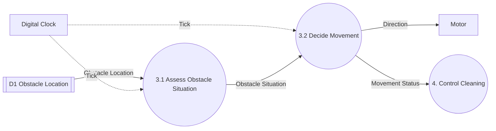
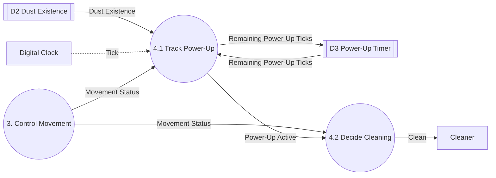

# DFD Level 2

System: RVC Controller
Parent: DFD Level 1, `artifacts/SA/DFD/dfd_level_1.md`
Sources: `docs/preliminary_requirements.md` (B1-B7), `docs/requirements_clarifications.md` (C1-C4, Q1-Q6), `artifacts/SA/event_list.md`, `artifacts/SA/context_diagram.md`, `artifacts/SA/DFD/dfd_level_0.md`, `artifacts/SA/DFD/dfd_level_1.md`

## Decomposition Scope

| Level 1 Process | Decomposed | Reason |
|---|---|---|
| 1 Detect Obstacle | No | Functional primitive. It copies three Boolean sensor values into D1; splitting it into per-sensor processes would add no function the requirements describe. Its Level 1 Process Specification is complete. |
| 2 Detect Dust | No | Functional primitive. It copies one Boolean sensor value into D2. |
| 3 Control Movement | Yes → 3.1, 3.2 | It mixes two functions: classifying the obstacle situation (B3, B4, C1, Q6) and sequencing the movement over several ticks (stop, turn, backward, forward; B3, B4, C2). |
| 4 Control Cleaning | Yes → 4.1, 4.2 | It mixes two functions: counting the 5-tick power-up (B5, C3) and choosing the cleaning command (B1-B3, B5). |

## Diagram 3: Control Movement

Solid arrows are data flows. Dashed arrows are control flows. `[[ ]]` nodes are Data Stores. `4. Control Cleaning` is a sibling Level 1 process, shown only as the destination of `Movement Status`.

### Processes

| Process ID | Process Name | Responsibility | Requirements |
|---|---|---|---|
| 3.1 | Assess Obstacle Situation | On each Tick, reads D1 and classifies the obstacles into one Obstacle Situation. Applies the right-first rule (C1) and uses left/right only when the front is blocked (Q6 assumption). | B3, B4, C1, Q6 |
| 3.2 | Decide Movement | On each Tick, chooses the Direction from the Obstacle Situation and the current avoidance step: stop first (C2), then turn, or move backward then turn; go forward when clear. Reports Movement Status to Process 4. | B2, B3, B4, C1, C2 |

The avoidance step (stopping, turning, moving backward) is control state that persists across ticks. It stays inside 3.2 at this level. Level 3 separates it from 3.2 as the Controller, which Level 4 describes as an FSM.

### Balancing with Process 3

| Process 3 Flow | Direction | Category | Level 2 Process | Balanced |
|---|---|---|---|---|
| Obstacle Location (from D1) | Input | Data | 3.1 | Yes |
| Tick | Input | Control | 3.1, 3.2 | Yes (same event to both) |
| Direction | Output | Data | 3.2 | Yes |
| Movement Status | Output | Data | 3.2 | Yes |

Internal flow added: `Obstacle Situation` (3.1 → 3.2).

## Diagram 4: Control Cleaning

Solid arrows are data flows. Dashed arrows are control flows. `[[ ]]` nodes are Data Stores. `3. Control Movement` is a sibling Level 1 process, shown only as the source of `Movement Status`.

### Processes

| Process ID | Process Name | Responsibility | Requirements |
|---|---|---|---|
| 4.1 | Track Power-Up | On each Tick, starts a 5-tick power-up when dust is detected while moving forward, counts it down, and reports whether power-up is active this tick. | B5, C3 |
| 4.2 | Decide Cleaning | Chooses the Clean command: Stop while avoiding, Power Up while power-up is active, otherwise Start. Runs when 4.1 reports Power-Up Active for the tick. | B1, B2, B3, B5 |

### Data Store

| ID | Data Store | Contents | Written by | Read by | Justification |
|---|---|---|---|---|---|
| D3 | Power-Up Timer | Remaining Power-Up Ticks (0-5) | 4.1 | 4.1 | The 5-tick count (C3) must persist across ticks. Level 1 deferred this decision to Level 2. |

### Balancing with Process 4

| Process 4 Flow | Direction | Category | Level 2 Process | Balanced |
|---|---|---|---|---|
| Dust Existence (from D2) | Input | Data | 4.1 | Yes |
| Movement Status | Input | Data | 4.1, 4.2 | Yes (same flow to both) |
| Tick | Input | Control | 4.1 | Yes |
| Clean | Output | Data | 4.2 | Yes |

Internal items added: `Power-Up Active` (4.1 → 4.2), `Remaining Power-Up Ticks` (4.1 ↔ D3), Data Store D3.

## Overall Balancing with Level 0

| Level 0 Flow | Level 1 Process | Level 2 Process |
|---|---|---|
| Front Sensor Input | 1 | 1 (not decomposed) |
| Left Sensor Input | 1 | 1 (not decomposed) |
| Right Sensor Input | 1 | 1 (not decomposed) |
| Dust Sensor Input | 2 | 2 (not decomposed) |
| Tick | 3, 4 | 3.1, 3.2, 4.1 |
| Direction | 3 | 3.2 |
| Clean | 4 | 4.2 |

No external flow was added or removed. All new flows and D3 are internal to their parent processes.

## Open Issues Affecting Level 2

Update 2026-11-08: Q1, Q2, Q3 are resolved by C5, C6, C7 and applied at Level 3 and in the Level 4 FSM.

| ID | Affects | Effect at Level 2 |
|---|---|---|
| Q1 | 3.2 | Turn direction after backward movement, and what to do if left and right are still blocked. |
| Q2 | 3.2 | Number of ticks spent moving backward. |
| Q3 | 3.2 | Number of ticks spent stopped (C2). |
| Q4 | 4.1 | Whether dust detected while Remaining Power-Up Ticks > 0 resets the count to 5 or is ignored. |
| Q5 | 4.1 | Whether D3 is cleared or kept when Movement Status becomes Avoiding. |
| Q6 | 3.1 | Assumed: left/right obstacles are ignored while the front is clear. |
| C4 | 3.2 | Resolved: obstacles do not disappear, so the Situation seen when stopping does not become Clear before the avoidance completes. 3.2 has no "front cleared while stopped" branch. |
| — | 4.1 | B5 does not say whether dust detected while Avoiding starts a power-up. Level 1 (Process 4) already limits it to moving forward; Level 2 keeps that. |
