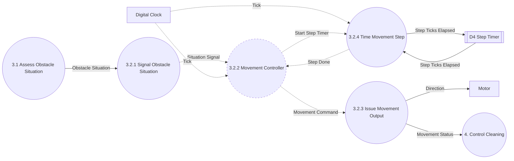

# DFD Level 3

System: RVC Controller
Parent: DFD Level 2, `artifacts/SA/DFD/dfd_level_2.md`
Sources: `docs/preliminary_requirements.md` (B1-B7), `docs/requirements_clarifications.md` (C1-C8, Q4-Q6), `artifacts/SA/DFD/dfd_level_0.md`, `artifacts/SA/DFD/dfd_level_1.md`, `artifacts/SA/DFD/dfd_level_2.md`

## Decomposition Scope

| Level 2 Process | Decomposed | Reason |
|---|---|---|
| 1 Detect Obstacle | No | Primitive since Level 2. |
| 2 Detect Dust | No | Primitive since Level 2. |
| 3.1 Assess Obstacle Situation | No | Primitive. A single stateless classification of D1 (see its Process Specification). |
| 3.2 Decide Movement | Yes → 3.2.1, 3.2.2, 3.2.3, 3.2.4 | It mixes control and data processing: it keeps the avoidance step across ticks (control state), counts the 5-tick stop, backward, and turn periods (C6, C7, C8), and produces the Direction and Movement Status data. Level 3 separates the control part as the Controller (sa-dfd Step 5.4). |
| 4.1 Track Power-Up | No | Primitive. Its only state is a number (Remaining Power-Up Ticks) kept in D3 and handled by arithmetic, not by mode sequencing. |
| 4.2 Decide Cleaning | No | Primitive. A stateless choice among three Clean values. |

## Diagram 3.2: Decide Movement

Solid arrows are data flows. Dashed arrows are control flows. `3.2.2 Movement Controller` is drawn with a dashed border: it is a control process. `3.1` and `4. Control Cleaning` are shown only as the source and destination of the parent's flows.

## Processes

| Process ID | Process Name | Type | Responsibility | Requirements |
|---|---|---|---|---|
| 3.2.1 | Signal Obstacle Situation | Data | Converts the Obstacle Situation data from 3.1 into a Situation Signal control flow for the Controller. | B3, B4, C1 |
| 3.2.2 | Movement Controller | Control | Keeps the current state (Forward, Stopping, Backing, Turning Right, Turning Left). On each Tick, uses Situation Signal and Step Done to choose the next state, issues one Movement Command, and starts the step timer when a 5-tick step begins. Specified by the Level 4 FSM. | B2, B3, B4, C1, C2, C4-C8 |
| 3.2.3 | Issue Movement Output | Data | When a Movement Command arrives, sends the matching Direction to the Motor and the matching Movement Status to Process 4. | B2, B3, B4 |
| 3.2.4 | Time Movement Step | Data | Counts the ticks of the current stop, backward, or turn step in D4 and signals Step Done when 5 ticks have elapsed. | C6, C7, C8 |

## Data Store

| ID | Data Store | Contents | Written by | Read by | Justification |
|---|---|---|---|---|---|
| D4 | Step Timer | Step Ticks Elapsed (Idle or 0-5) | 3.2.4 | 3.2.4 | The 5-tick stop (C7), backward movement (C6), and turn (C8) must be counted across ticks. The count is numeric data, so it is kept outside the control process, like D3 for the power-up. |

## Controller Interface (input to Level 4)

| Item | Kind | Values |
|---|---|---|
| Tick | Input event (control) | — |
| Situation Signal | Input condition (control) | Clear, Right Open, Left Open, All Blocked |
| Step Done | Input condition (control) | Present on the tick when the running stop, backward, or turn step has lasted 5 ticks |
| Movement Command | Output action (control) | Forward, Stop, Turn Right, Turn Left, Backward |
| Start Step Timer | Output action (control) | — |
| Controller states | Internal | Forward (initial), Stopping, Backing, Turning Right, Turning Left |

## Controller Behavior

| Current State | Tick condition | Actions | Next State | Source |
|---|---|---|---|---|
| Forward | Clear | Forward | Forward | B2 |
| Forward | not Clear | Stop, Start Step Timer | Stopping | B3, C2, C7 |
| Stopping | not Step Done | Stop | Stopping | C7 |
| Stopping | Step Done and Right Open | Turn Right, Start Step Timer | Turning Right | B3, C1, C8 |
| Stopping | Step Done and Left Open | Turn Left, Start Step Timer | Turning Left | B3, C8 |
| Stopping | Step Done and All Blocked | Backward, Start Step Timer | Backing | B4, C6 |
| Backing | not Step Done | Backward | Backing | C6 |
| Backing | Step Done and All Blocked | Backward, Start Step Timer | Backing | C5, C6 |
| Backing | Step Done and Right Open | Turn Right, Start Step Timer | Turning Right | C5, C8 |
| Backing | Step Done and Left Open | Turn Left, Start Step Timer | Turning Left | C5, C8 |
| Turning Right | not Step Done | Turn Right | Turning Right | C8 |
| Turning Right | Step Done | Forward | Forward | B3, B4, C8 |
| Turning Left | not Step Done | Turn Left | Turning Left | C8 |
| Turning Left | Step Done | Forward | Forward | B3, B4, C8 |

- **C4 applied:** obstacles do not disappear, and moving straight backward keeps the front obstacle ahead. So Clear cannot arrive in Stopping or Backing, and "left and right still both blocked" (C5) equals All Blocked.
- **Durations:** stop, backward, and turn each last 5 ticks (C7, C6, C8). Turning is split into two states so that the same turn direction is issued for all 5 ticks.

## Balancing with Process 3.2

| Process 3.2 Flow | Direction | Category | Level 3 Process | Balanced |
|---|---|---|---|---|
| Obstacle Situation | Input | Data | 3.2.1 | Yes |
| Tick | Input | Control | 3.2.2, 3.2.4 | Yes (same event to both) |
| Direction | Output | Data | 3.2.3 | Yes |
| Movement Status | Output | Data | 3.2.3 | Yes |

Internal items added: `Situation Signal`, `Movement Command`, `Start Step Timer`, `Step Done` (control), `Step Ticks Elapsed` (data), Data Store D4.

## Overall Balancing with Level 0

| Level 0 Flow | Level 1 | Level 2 | Level 3 |
|---|---|---|---|
| Front Sensor Input | 1 | 1 | 1 |
| Left Sensor Input | 1 | 1 | 1 |
| Right Sensor Input | 1 | 1 | 1 |
| Dust Sensor Input | 2 | 2 | 2 |
| Tick | 3, 4 | 3.1, 3.2, 4.1 | 3.1, 3.2.2, 3.2.4, 4.1 |
| Direction | 3 | 3.2 | 3.2.3 |
| Clean | 4 | 4.2 | 4.2 |

No external flow was added or removed.

## Execution Order Within One Tick

1. 3.1 reads D1 and produces Obstacle Situation; 3.2.1 converts it to Situation Signal.
2. 3.2.4 advances D4 and, if 5 ticks have elapsed, emits Step Done.
3. 3.2.2 takes its transition and issues Movement Command (and Start Step Timer when a step begins).
4. 3.2.3 produces Direction and Movement Status.
5. 4.1, then 4.2, use Movement Status to produce Clean.

## Open Issues Affecting Level 3 and Level 4

| ID | Affects | Status |
|---|---|---|
| Q1 → C5 | 3.2.2 | Resolved: turn right after backing; back again if left and right are still blocked. |
| Q2 → C6 | 3.2.2, 3.2.4 | Resolved: backward lasts 5 ticks. |
| Q3 → C7 | 3.2.2, 3.2.4 | Resolved: stop lasts 5 ticks. |
| C5 edge | 3.2.2 | Resolved: after backing, Left Open turns left (C5 updated). |
| C8 | 3.2.2, 3.2.4 | Resolved: a turn lasts 5 ticks. |
| Q4, Q5 | 4.1 | Still open. |
| Q6 | 3.1 | Assumption unchanged: left/right ignored while the front is clear. |
