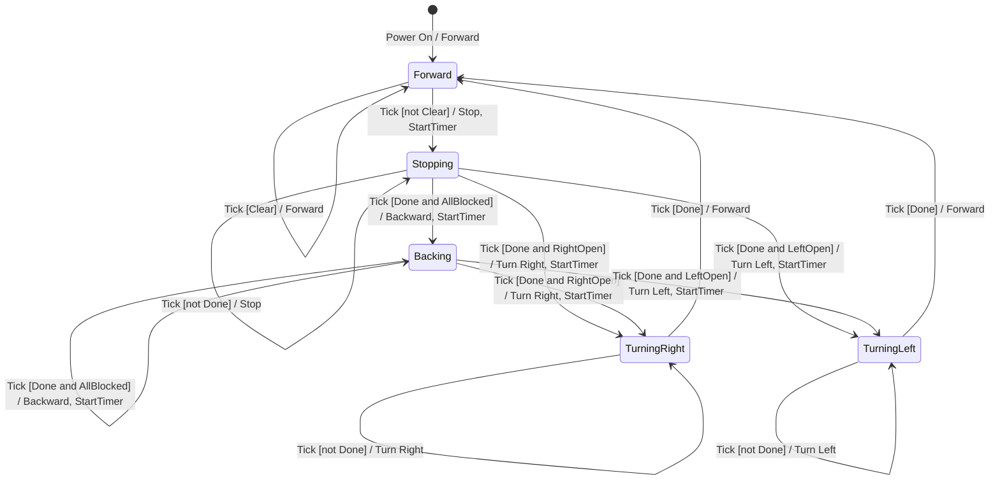

# DFD Level 4: Movement Controller FSM

System: RVC Controller
Controller: Process 3.2.2 Movement Controller, `artifacts/SA/DFD/dfd_level_3.md`
Sources: `docs/preliminary_requirements.md` (B1-B7), `docs/requirements_clarifications.md` (C1-C8, Q6)

## Controller Inputs and Outputs

| Item | Kind | Source / Destination | Values |
|---|---|---|---|
| Tick | Event | Digital Clock | — |
| Situation Signal | Condition | 3.2.1 | Clear, Right Open, Left Open, All Blocked |
| Step Done | Condition | 3.2.4 | Present when the current stop, backward, or turn step has lasted 5 ticks |
| Movement Command | Action | 3.2.3 | Forward, Stop, Turn Right, Turn Left, Backward |
| Start Step Timer | Action | 3.2.4 | — |

Abbreviations in labels: `Clear`, `RightOpen`, `LeftOpen`, `AllBlocked` are Situation Signal values; `Done` is Step Done; `StartTimer` is Start Step Timer.

## FSM

## States

| State | Meaning | Movement Command while in state | Movement Status (via 3.2.3) |
|---|---|---|---|
| Forward | Moving forward with cleaning. Initial state. | Forward | Forward |
| Stopping | Stopped in front of an obstacle for 5 ticks. | Stop | Avoiding |
| Backing | Moving backward for 5 ticks because front, left, and right are blocked. | Backward | Avoiding |
| TurningRight | Turning right for 5 ticks. | Turn Right | Avoiding |
| TurningLeft | Turning left for 5 ticks. | Turn Left | Avoiding |

Turning is split into two states because the Controller must keep issuing the same turn direction for 5 ticks.

## Transition Table

| # | Current State | Event | Condition | Action | Next State | Source |
|---|---|---|---|---|---|---|
| T0 | [*] | Power On | — | Forward | Forward | B1, B2 |
| T1 | Forward | Tick | Clear | Forward | Forward | B2 |
| T2 | Forward | Tick | not Clear | Stop, Start Step Timer | Stopping | B3, C2, C7 |
| T3 | Stopping | Tick | not Step Done | Stop | Stopping | C7 |
| T4 | Stopping | Tick | Step Done and Right Open | Turn Right, Start Step Timer | TurningRight | B3, C1, C8 |
| T5 | Stopping | Tick | Step Done and Left Open | Turn Left, Start Step Timer | TurningLeft | B3, C8 |
| T6 | Stopping | Tick | Step Done and All Blocked | Backward, Start Step Timer | Backing | B4, C6 |
| T7 | Backing | Tick | not Step Done | Backward | Backing | C6 |
| T8 | Backing | Tick | Step Done and All Blocked | Backward, Start Step Timer | Backing | C5, C6 |
| T9 | Backing | Tick | Step Done and Right Open | Turn Right, Start Step Timer | TurningRight | C5, C8 |
| T10 | Backing | Tick | Step Done and Left Open | Turn Left, Start Step Timer | TurningLeft | C5, C8 |
| T11 | TurningRight | Tick | not Step Done | Turn Right | TurningRight | C8 |
| T12 | TurningRight | Tick | Step Done | Forward | Forward | B3, B4, C8 |
| T13 | TurningLeft | Tick | not Step Done | Turn Left | TurningLeft | C8 |
| T14 | TurningLeft | Tick | Step Done | Forward | Forward | B3, B4, C8 |

## Timing Example

Obstacle ahead with the right clear, first detected at tick t:

| Tick | State before | Condition | Command | State after |
|---|---|---|---|---|
| t | Forward | RightOpen | Stop (timer starts) | Stopping |
| t+1 to t+4 | Stopping | not Done | Stop | Stopping |
| t+5 | Stopping | Done, RightOpen | Turn Right (timer starts) | TurningRight |
| t+6 to t+9 | TurningRight | not Done | Turn Right | TurningRight |
| t+10 | TurningRight | Done | Forward | Forward |

Stop covers ticks t to t+4 and the turn covers t+5 to t+9, 5 ticks each (C7, C8). Backing works the same way: 5 Backward ticks, then the decision on the next tick (C6).

## Validation

| Check | Result |
|---|---|
| All states defined | Yes: Forward, Stopping, Backing, TurningRight, TurningLeft. |
| Initial state | Forward. |
| Valid source and target for every transition | Yes: T0-T14. |
| Input events from DFD | Tick (Digital Clock), Situation Signal (3.2.1), Step Done (3.2.4), all in Level 3. |
| Output actions match Controller outputs | Movement Command values and Start Step Timer, both Level 3 outputs of 3.2.2. |
| Conflicting conditions | None. Forward splits on Clear. Stopping and Backing split first on Step Done, then on the Situation Signal (Right Open, Left Open, All Blocked are mutually exclusive). Turning states split on Step Done only. |
| Priority | Step Done is checked first. The Situation Signal matters only on the tick Step Done is present. Right Open takes priority over Left Open by its definition in 3.1 (C1). |
| Missing conditions | Stopping and Backing with Step Done and Clear have no transition. This is intentional: C4 (obstacles do not disappear) makes Clear impossible there. |
| Unreachable states | None. Stopping via T2; Backing via T6; TurningRight via T4, T9; TurningLeft via T5, T10. |
| States without an outgoing transition | None. |
| Cycle check | Backing can repeat (T8) while all directions stay blocked. The requirements set no limit on repeats. |

## Notes

- The Situation Signal is ignored during a turn. By C4 the obstacles do not move, and the requirements do not describe interrupting a turn.
- Q4 and Q5 (power-up) affect Process 4.1 only, not this FSM.
- The FSM has no Process Specification, per AGENTS.md. Process 3.2.2's specification refers to it.
